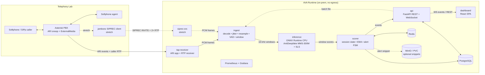
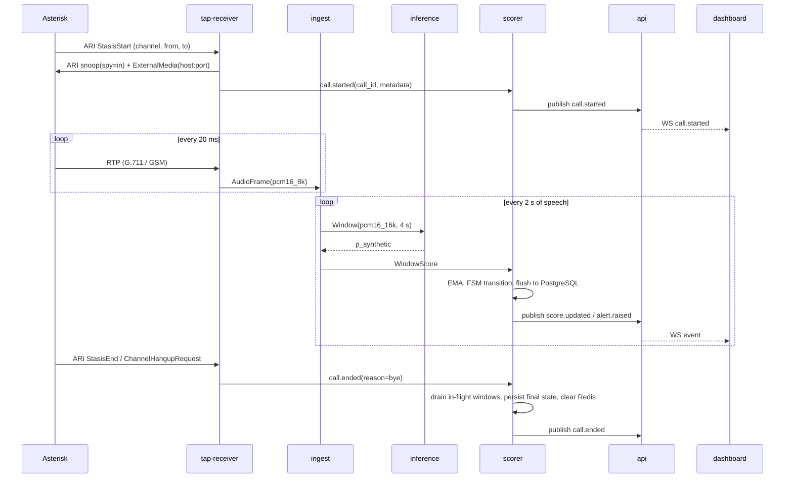

# AVA: Acoustic Veracity Analyzer — System Architecture

| Field | Value |
|---|---|
| Version | 0.2 (draft) |
| Date | 2026-10-01 |
| Supersedes | v0.1 of 2026-09-04 |
| Companion | [prd.md](prd.md) v0.2 |
| Status | Draft for supervisor review |

## Changes since v0.1

| Change | Sections |
|---|---|
| Model is AntiDeepfake MMS-300M truncated to 7 to 8 layers with an SLS head; DuaBiMamba removed; XLS-R + SLS is the fallback | §1, §2.3, §4, ADR-1, ADR-2, §11 |
| Primary live-call ingestion is the Asterisk passive tap (`tap-receiver`: ARI application plus RTP receiver); the SIPREC Recording Server is a stretch component driven by jambonz | §1, §2.1, §3, §6, §7, §9, ADR-4 |
| G.711 and GSM decoded live; AMR-NB decoded in the file path and from replayed captures | §2.1, §6 |
| Generators and genuine sources updated; same-speaker rule, single processing pipeline, quality checks and leakage probes added to the training plane | §5, ADR-10, ADR-14 |
| Scorer state machine fully specified (undetermined, ended_open, re-alert, per-hop flush, degraded cap); first-verdict arithmetic corrected | §2.4, §3, ADR-11 |
| Capacity refusal, batch-versus-live priority, input bounds, job endpoint, language-ID hook | §2.3, §2.5 |
| Regulatory wording corrected; repository guard and ethics controls added | §8 |
| Repository layout updated (CLAUDE.md, `.claude/`, `tap_receiver`, `docs/viva`, `docs/reviews`) | §9 |

---

## 1. Architecture Overview

AVA is a passive, on-premises detection system with three planes:

1. **Training plane** (offline, run by the team): dataset assembly, synthesis, augmentation, quality checks, model fine-tuning, evaluation, ONNX export. Produces versioned model artifacts.
2. **Runtime plane** (deployed at the operator's edge): passive tap ingestion, streaming inference, session scoring, API, dashboard, storage. Zero external network egress.
3. **Telephony lab** (simulated operator PBX): Asterisk plus softphones and a call generator, used for integration testing, the live-call campaign and the SDP demo.



**Design principles**

- **Passive tap.** AVA only ever receives a copy of the media. It never sits in the signaling or media path, so its failure cannot affect a call (PRD FR-T4).
- **Data minimization.** Audio lives in memory as short windows and is discarded after scoring. Persistence is scores, metadata, and optional bounded snippets.
- **Egress-free by construction.** No component needs internet access at runtime. Enforced by Kubernetes NetworkPolicy and verified by test.
- **CPU-first inference.** The model is truncated and quantized to fit a real-time factor of 0.375 at batch 1 on a commodity 8-core server.
- **One conditioning path.** The `ingest` module that resamples, normalizes and windows audio at runtime is the same code used to build the training set (PRD A2, FR-D12).
- **Boring, replaceable parts.** Every service has a narrow contract so any one can be swapped (the head, the ingestion path, the PBX).

---

## 2. Runtime Components

### 2.1 `tap-receiver` — Passive Tap Ingestion

**Responsibility.** Receive forked call audio and call lifecycle events from the PBX and hand decoded PCM frames to `ingest`.

**Primary path: Asterisk ARI tap (PRD FR-T2).**
- A small ARI application (Python, `asyncio` WebSocket client to `/ari/events`) subscribes to channel events. On `StasisStart` for a call it attaches a **snoop channel** to the caller channel with `spy=in` (caller direction only) and bridges it to an **ExternalMedia** channel that sends plain RTP (`ulaw` or `slin16`) to a host and port owned by the receiver.
- The RTP receiver reads raw UDP, parses RTP headers (about 100 lines), and decodes the payload: G.711 μ-law and A-law (NumPy), GSM 06.10 (`libgsm` via `pygsm` or an `ffmpeg` pipe). AMR-NB decoding (all eight modes, SID/DTX, both RFC 4867 payload formats, via `opencore-amr`) lives in the same decoder module but is exercised by the file path and by replayed RTP captures, not by live Asterisk calls (PRD D8).
- Call ID, from, to and timestamps come from the ARI channel fields. Call end comes from `StasisEnd` or `ChannelHangupRequest`. A tap socket with no packets for 30 s is torn down with `call.ended reason=timeout`.
- Above `max_calls`, a new call is not tapped and a `system.health reason=capacity` event is emitted; the call itself continues (PRD FR-I9).
- Emits `AudioFrame{call_id, direction, ts, pcm16_8k}` to `ingest` over an in-process asyncio queue (same pod) or Redis Streams (separate pods).

**Agent direction (PRD FR-I8, P2 on this path).** A second snoop channel with `spy=out`. Scoring starts only after an event marking a human agent answered; IVR prompts are excluded.

**Fallbacks (PRD FR-T7).** If the snoop plus ExternalMedia combination does not deliver RTP in the Phase 0 spike: MixMonitor or `chan_spy` to a named pipe; then FreeSWITCH as the lab PBX. The RTP receiver and decoders are shared by every path.

### 2.1a `siprec-srs` — SIPREC Recording Server (stretch, PRD FR-T6)

Acts as a SIPREC Session Recording Server (RFC 7865 metadata, RFC 7866 protocol): accepts the INVITE with `rs-metadata` XML, answers with two receive-only RTP ports, receives the caller and agent legs, handles re-INVITE and BYE. Asterisk has no SIPREC client, so the lab drives it with **jambonz** as the Session Recording Client. Implemented with `pjsua2` bindings or a minimal asyncio SIP UAS, sharing the RTP receiver and decoders with `tap-receiver`. It exists to show the production-equivalent interface that real SBCs speak; it is not on the demo's critical path.

### 2.2 `ingest` — Audio Conditioning

**Responsibility.** Turn a per-call stream of 8 kHz frames into scoring-ready windows. The same module, with a file source, builds the training set.

Pipeline per call:
1. **Jitter buffer.** 60 ms depth, sequence-number reorder, packet-loss concealment (repeat last 20 ms frame, then zero-fill after 3 consecutive losses). A window with more than 10% concealed samples is dropped and the call is marked `quality=low`; sustained loss above 5% emits `system.health reason=media_quality` (PRD FR-I2).
2. **Resample 8 kHz → 16 kHz.** `soxr` with a high-quality band-limited filter. This adds no information above 4 kHz; the model is trained on identically upsampled audio so the domain matches.
3. **VAD.** Silero VAD (ONNX, CPU, about 1 ms per 30 ms frame). Frames below speech probability 0.5 are excluded from window accumulation but still advance time. A call with no speech reports `state=no_speech` with seconds since last speech.
4. **Windowing.** Ring buffer of speech audio; emit a 4 s window every 2 s of accumulated speech (`window_s`, `hop_s` configurable). A window is scored only if at least 2.5 s of it is speech. At call end a tail of at least 1.5 s is zero-padded to 4 s and marked `partial` (PRD FR-I3).
5. **Normalization.** Peak-normalize to −3 dBFS; the same op is applied in training.
6. **Language hint (P1, PRD FR-A5).** A lightweight language-ID pass on the first scored windows; if the language is not Urdu or Punjabi the call or file is marked `out_of_domain` and no alert is raised.

Output: `Window{call_id, direction, window_idx, t_start, t_end, partial, pcm16_16k[64000]}`.

Batch mode reuses this module with a file source: `ffmpeg` decodes, stereo is downmixed, any input is resampled to 8 kHz first and then through steps 2 to 5, so wideband files see the same conditioning as phone audio; wideband sources are flagged `out_of_domain` (PRD FR-A1).

### 2.3 `inference` — Model Serving

**Responsibility.** Score windows with the exported ONNX model.

- ONNX Runtime 1.18+ CPU execution provider, INT8 dynamic-quantized graph.
- Per worker: `intra_op_num_threads=4`, `inter_op_num_threads=1`; workers = physical cores / 4 (2 workers on the reference box, each handling about 4 calls).
- **Micro-batching.** Windows arriving within a 100 ms collection interval are batched (max batch 4 live, 8 batch) to raise CPU throughput without hurting latency.
- **Priority.** Live windows are scheduled first; batch jobs use at most 25% of inference capacity while live calls are active (PRD FR-I9).
- **Model contract.** Input: `float32[B, 64000]` at 16 kHz. Output: `logits[B, 2]`, `embedding[B, 256]`. Post-processing applies the calibrated temperature from the model card and returns `p_synthetic`.
- Model files load from `/models/ava-<version>.onnx` on a read-only volume. `model_card.json` alongside declares version, backbone, kept layers, window size, sample rate, calibration temperature and licence restriction; `inference` refuses to start if the card and config disagree, or if either file is missing (PRD FR-O4).
- Exposes an internal HTTP `/score`; `scorer` calls it, or in the single-pod deployment it is an in-process call (ADR-9).

### 2.4 `scorer` — Session State and Alert Logic

**Responsibility.** Maintain per-call state and decide when to alert.

- Per scored direction: EMA of `p_synthetic` with α = 0.4, count of scored windows, max score, recent scores ring (last 30), quality and degraded flags.
- **Minimum evidence (PRD FR-I5).** A provisional score is published after the first window. No state change until N windows (default 2, set from the time-versus-evidence curve in PRD FR-M9). A call or file that ends with fewer than N speech windows reports `verdict=undetermined`, never genuine.
- **Alert state machine (hysteresis, PRD FR-I7).** All transitions are defined:
  - `monitoring → suspicious` when EMA ≥ `suspicious_enter` (0.60)
  - `suspicious → alert` when EMA ≥ `alert_enter` (0.75) for 2 consecutive windows
  - `monitoring → alert` is not allowed directly; it passes through `suspicious`
  - `alert → suspicious` when EMA < `alert_exit` (0.55)
  - `suspicious → monitoring` when EMA < `suspicious_exit` (0.40)
  - Re-entering `alert` after a clear raises a new alert with a new `alert_id`
  - Config is validated at load: `0 < suspicious_exit < suspicious_enter ≤ 1`, `alert_exit < alert_enter`, `0 < hop ≤ window`, `window == model_card.window`; reloads apply to calls started after the reload.
- If agent-direction scoring is enabled, the call state is the more severe of the two directions, and the card shows which direction drives it.
- On entering `alert`: persist the alert row, publish `alert.raised`, and if retention is on, persist the 30 s ring buffer ending at the alert as one snippet per `alert_id`.
- On `call.ended`: the final state is persisted; an open alert is stored as `ended_open` with no `alert.cleared` emitted; `call.ended` carries `final_state`, `reason` (`bye`, `timeout`, `monitor_lost`) and `speech_seconds`.
- **Degraded mode (PRD FR-I10).** If inference falls behind, the stride grows instead of the queue; stride is capped at 4× hop, beyond which the call shows `state=unmonitored`; degraded clears only after 30 s under budget; `score.updated` carries `degraded` and the effective stride.
- **Durability (PRD FR-I11).** State is held in Redis (hash per call) and flushed to PostgreSQL every hop, so a `scorer` restart resumes from persisted state. Cleanup drains or cancels in-flight windows; a late result for an unknown `call_id` is discarded. If `tap-receiver` restarts, every open session emits `call.ended reason=monitor_lost`.
- Publishes events to a Redis pub/sub channel consumed by `api`.

### 2.5 `api` — FastAPI Service

**Responsibility.** External contract for the dashboard, batch analysis, and operators.

- FastAPI + Uvicorn, Pydantic v2 models, OpenAPI at `/docs`.
- REST endpoints per PRD §5.6; WebSocket `/v1/events` fans out Redis pub/sub events with an optional call-ID filter.
- Batch: input bounds enforced (10 min, 100 MB, decodable), file written to a temp dir, pushed through `ingest` (file source) and `inference`; results returned synchronously for files up to 60 s and as a job (`202` plus `GET /v1/jobs/{id}`) beyond; temp files deleted after processing.
- Timelines: the last 30 minutes of a call at full resolution in memory, older points downsampled, full history in PostgreSQL.
- Auth (P1): session cookie after username and password login; Argon2; two roles. Without it, the config endpoint is disabled (file plus reload only) and audit entries record `actor=system`.
- Audit middleware writes every mutating request to `audit_log`.
- Webhook (P2): when enabled, one NetworkPolicy egress rule to the configured host and port only; three retries; failures logged.

### 2.6 `dashboard` — React SPA

- React 18 + TypeScript + Vite, served as static files by the `api` container so there is one origin and no CORS.
- State: TanStack Query for REST, a small WebSocket hook for live events.
- Components: live call board (states `monitoring`, `suspicious`, `alert`, `no_speech`, `unmonitored`, with quality and degraded flags), alert feed, **per-window timeline** shared by the live and batch views (PRD FR-U3, P0), batch upload page with job polling, call detail and history (P1), settings (P1).
- The limitation text from PRD §1.4 is visible in the interface.
- Charts: lightweight SVG sparklines, no heavy chart library. All fonts and assets bundled; no CDN references.

### 2.7 Storage

| Store | Purpose | Retention |
|---|---|---|
| **PostgreSQL 16** | `calls`, `call_directions`, `window_scores` (flushed per hop), `alerts`, `alert_feedback`, `users`, `audit_log`, `batch_jobs`, `settings` | Indefinite (metadata and scores only) |
| **Redis 7** | Live session state, event pub/sub, micro-batch queues | Ephemeral; AOF persistence on |
| **MinIO** (or plain PVC directory) | Optional alert snippets (30 s WAV, AES-256-GCM, one per alert ID) and batch uploads (deleted after processing) | TTL, default 7 days, default OFF; switching off purges within one cleanup run |

### 2.8 Observability

- Prometheus metrics from every service: stage latencies (histograms), active calls, refused calls, queue depth, inference batch size, alerts per minute, dropped windows, concealed-sample ratio.
- Grafana with a provisioned dashboard (P1). Structured JSON logs to stdout collected by the cluster.

---

## 3. Data Flow: Live Call



**Latency budget per hop (reference box, target p95):**

| Stage | Budget |
|---|---|
| RTP arrival → frame available | 60 ms (jitter buffer) |
| Resample + VAD + windowing | 20 ms |
| Micro-batch wait | ≤ 100 ms |
| ONNX inference (4 s window, INT8, 4 threads) | ≤ 1,200 ms |
| Scorer + flush + publish | 20 ms |
| WS to browser render | ≤ 200 ms |
| **Total, window end → UI** | **≤ 1.6 s** |

**First-verdict arithmetic (PRD FR-I6).** The first window completes at 4 s of speech and yields a provisional score about 1.5 s later. The second window completes at 6 s of speech, so the earliest state change is at 6 s plus the p95 window latency, about 7.5 s. With hop 2 s and inference ≤ 1.2 s the real-time factor is about 0.3 per call at one call per worker thread group; the micro-batcher raises capacity to the 8-call target.

---

## 4. Model Architecture

### 4.1 Backbone: AntiDeepfake MMS-300M, truncated

- Start from the AntiDeepfake MMS-300M checkpoint (Ge et al. 2025): the Meta MMS-300M multilingual self-supervised model post-trained for deepfake detection on about 74k hours across 100+ languages. Pretraining of the MMS family includes Urdu and Punjabi, so the representations already model South Asian phonetics, and the post-training already models synthesis artifacts. The checkpoint is obtained, licence-recorded and converted to a Hugging Face or directly exportable format in Phase 0 (PRD task 0.7, R2).
- **Layer truncation.** Keep the CNN feature encoder plus the first 7 to 8 transformer layers. Layer-wise analyses find spoof-discriminative information concentrated in lower and middle layers; truncation to this depth is what makes 8 concurrent calls fit on one CPU. The exact cut is chosen by a sweep over 4, 6, 7, 8, 10 and 12 kept layers, run with the SLS head (PRD task 2.4).
- Fine-tune with a small backbone learning rate (2e-5) and a larger head learning rate (1e-3), with the CNN feature encoder frozen for the first epochs.
- **Fallback:** XLS-R 300M (same wav2vec 2.0 family, pretrained on Urdu and Punjabi but not post-trained for deepfakes) with the same SLS head and truncation (PRD A3).

### 4.2 Head: SLS (sensitive layer selection)

- Input: hidden states from every retained layer, `[L, T, 1024]` with T ≈ 199 for 4 s at 20 ms stride.
- A learned, softmax-normalized weighting over the L retained layers selects the artifact-rich layers (the "sensitive" layers) and sums them to `[T, 1024]`; a projection to 256-d, attentive statistics pooling (mean and standard deviation with learned attention) to a 256-d embedding, and a 2-class linear output.
- The weighting is learned over the retained layers only, so truncation and head are consistent (PRD review finding E41).
- Loss: weighted cross-entropy (OC-Softmax as an ablation). Training-time augmentation: RawBoost-style linear and nonlinear distortion plus the codec chain from §5.
- **Why not Mamba.** v0.1 specified a dual-column bidirectional Mamba head. Published comparisons put it about one EER point ahead of simpler heads, but its fused selective-scan kernel has no clean ONNX export on CPU and would have required a hand-written reference scan. SLS exports as ordinary matrix operations, and the field's own assessment is that gains now come from data rather than head design. The head ablation (PRD FR-M8) compares SLS against mean-pool plus MLP.

### 4.3 Export and Quantization

1. Confirm the converted checkpoint traces cleanly; no custom kernels are involved.
2. `torch.onnx.export` with opset 17, dynamic batch axis; fixed T (64,000 samples) to keep the graph static.
3. Validate parity on 100 dev windows (max |Δlogit| < 1e-3). The threshold is relaxed only if dev EER is unchanged.
4. ONNX Runtime dynamic INT8 quantization of MatMul and Linear ops; re-measure EER on dev. If the loss exceeds 0.3 points: try static quantization with a calibration set; if that also fails, ship FP32 and re-benchmark latency (PRD FR-M7).
5. Optional: graph optimization level `ORT_ENABLE_ALL`, save the optimized graph.
6. Benchmark on the reference box, record the CPU model and flags; write `model_card.json` (version, backbone, kept layers, window, sample rate, calibration temperature, ECE, licence restriction, limitation text).

### 4.4 Baselines

AASIST and RawNet2 (raw-waveform) and XLS-R + AASIST with RawBoost (the standard SSL baseline, public code) trained from their reference implementations on the same manifests, same augmentation, same speaker-disjoint splits. Reported side by side with AVA with bootstrap confidence intervals (PRD FR-M4, §6.2).

### 4.5 Evaluation outputs

- EER, minDCF (ASVspoof 5 DF-track cost) and FAR at FRR = 5% on every PRD FR-M5 partition, with 95% bootstrap intervals.
- Expected Calibration Error after temperature scaling.
- **Time-versus-evidence curve** (PRD FR-M9): EER and FAR as a function of 1, 2, 3, 4 and 6 windows of speech, per codec, from which N is chosen.
- **Per-dialect FAR** (PRD FR-M10) on dialect-held-out genuine sets meeting the 10-speaker, 500-clip floor.
- Offline evaluation scores one zero-padded window per 3 to 6 s clip; the minimum-evidence rule is evaluated on the live campaign and on concatenated clips of at least 8 s (PRD FR-M11).

---

## 5. Training Plane

```mermaid
flowchart TD
    A[Genuine sources<br/>Common Voice ur • Meta Omnilingual pnb_Arab • Habib Univ. • CSALT-LUMS • UrduSpeech (rights pending) • team recordings 60–80 speakers] --> SY
    S1[OmniVoice cloning<br/>from consented reference audio] --> SY[Synthetic generation<br/>same speakers as genuine]
    S2[Seed-VC + RVC voice conversion<br/>of genuine recordings] --> SY
    S3[MMS-TTS Urdu<br/>prompted with speaker reference] --> SY
    S4[Fish Audio S2<br/>held out, test only] --> SY
    S5[ElevenLabs<br/>only with written permission] -.-> SY
    A --> P
    SY --> P[One processing script<br/>trim silence • cut 3–6 s • loudness • 16 kHz<br/>codec chains + packet loss • QA checks • manifest row]
    P --> M[Manifest builder<br/>speaker-disjoint splits • same-speaker assertion<br/>held-out generator • held-out dialects • real-call set]
    M --> LP[Leakage probes<br/>silence-only • duration-only ≈ 50% EER]
    M --> TR[Fine-tuning<br/>PyTorch + HF Transformers<br/>MLflow tracking]
    TR --> EV[Evaluation<br/>EER • minDCF • FAR • ECE • per-subset • time-vs-evidence • per-dialect]
    EV --> EX[ONNX export + INT8]
    EX --> BM[CPU benchmark]
    BM --> ART[Model artifact<br/>ava-vX.onnx + model_card.json]
```

**Genuine sources (PRD FR-D1).** Common Voice Urdu capped at 30 clips per speaker; Meta Omnilingual ASR Corpus pnb_Arab (Shahmukhi); Habib University Punjabi corpus and UrduSpeech subject to access and rights; the genuine partition of the CSALT-LUMS Urdu deepfake set; team recordings of 60 to 80 Pakistani Punjabi speakers in 10 to 12 minute sessions (read speech, free speech with code-switching prompts, a role-play bank call) recorded over the Asterisk lab or a WAV web recorder. Pothwari, Saraiki and Hindko from Common Voice and Meta Omnilingual are test-only dialect sets. LDC2017S14 (real Pakistani Punjabi phone calls) is the real-call test set if the LDC Data Scholarship is granted.

**Synthetic generation (PRD FR-D2, D3, D9, D11).** Every fake's target voice is a consented speaker who also contributes genuine clips. OmniVoice clones from a 10 s reference and the same sentences the speaker read, including code-switched ones. Seed-VC and RVC convert genuine recordings to other consented target voices, keeping words, rhythm and accent, which makes them the main Punjabi source. MMS-TTS supplies Urdu volume prompted with speaker reference audio. Fish Audio S2 is held out for test only and must be absent from the AntiDeepfake checkpoint's documented training sources. ElevenLabs is used only with written research permission. Every synthetic clip records tool, version, source speaker and prompt.

**One processing script (PRD FR-D12, FR-D13).** Genuine and synthetic clips go through the identical path: trim silence, cut to 3 to 6 s, loudness-normalize, resample to 16 kHz through the shared `ingest` module, make codec versions (G.711, GSM 06.10, AMR-NB at 4.75 / 7.4 / 12.2, Opus or G.729, with packet loss 0 to 5% and jitter; `ffmpeg` with `libgsm`, `libopencore-amrnb`, `libopus`), run quality checks (length, silence ratio, loudness, noise score, language check, ASR check for synthetic clips), and write the manifest row. Noise and RIR via `audiomentations`. Per-partition distributions of duration, silence and loudness are reported and must overlap. The team listens to 5% of each batch; a batch with more than 10% failures is re-checked.

**Splits (PRD FR-D8, A4).** Speaker-disjoint 70/10/20, with a script asserting zero speaker overlap and that each speaker's genuine and synthetic clips land in the same split. Speakers who consented to recording but not cloning contribute genuine audio to the test split only. Test partitions: in-domain, held-out generator, held-out dialects, real phone calls. Leakage probes (silence-only and duration-only classifiers) must score near 50% EER before training proceeds.

**Compute and data locality (PRD D13).** Training on a lab GPU if available; otherwise a rented GPU, but raw and consented audio stay on university-controlled storage in Pakistan, and rented GPUs process consented data only if the consent form names off-site processing and the provider region is in-country. Raw audio, consent forms and speaker-level manifests never enter any repository (PRD FR-E3, FR-E6).

---

## 6. Telephony Lab

- **Asterisk 20 LTS** (or 21) in a container, PJSIP stack, two internal extensions (caller, agent), ARI enabled. The dialplan sends calls through a Stasis application that attaches the snoop and ExternalMedia channels described in §2.1. Version choice and the tap spike are Phase 0 task 0.9.
- **Endpoints.** Linphone or Zoiper softphones for the manual demo; **SIPp** scenarios with PCAP playback for automated tests that inject known genuine and synthetic WAVs.
- **Codec forcing.** Endpoints negotiate `ulaw` or `gsm` so each live codec path is exercised deliberately. AMR-NB is exercised by replaying captured AMR RTP into the receiver, since stock Asterisk cannot negotiate it.
- **SIPREC (stretch).** jambonz configured as a SIPREC client pointing at `siprec-srs`, to demonstrate the production-equivalent interface.
- **E2E test.** CI job: bring up Asterisk and AVA via compose; SIPp plays a synthetic Urdu file over `ulaw` and over `gsm`, assert an `alert.raised` event within 15 s; plays a genuine file, assert no alert; stops AVA mid-call, assert the call continues (PRD FR-T4).
- **Live-call campaign (PRD task 5.3).** At least 100 genuine and 100 synthetic calls per live codec; alert precision, recall and time-to-alert; AMR-NB on replayed captures.

---

## 7. Deployment

### 7.1 Containers

| Image | Base | Notes |
|---|---|---|
| `ava/tap-receiver` | `python:3.11-slim` + ffmpeg + libgsm + opencore-amr | ARI client plus UDP port range for RTP |
| `ava/siprec-srs` | `python:3.11-slim` + pjsip + ffmpeg | Stretch; UDP 5060 and RTP range |
| `ava/ingest-inference` | `python:3.11-slim` + onnxruntime + soxr | Ingest, inference and scorer in one process for the single-node demo; split into separate Deployments when scaling |
| `ava/api` | `python:3.11-slim` | Serves the dashboard static build too |
| `postgres:16`, `redis:7`, `minio`, `prom/prometheus`, `grafana/grafana` | upstream, digest-pinned (P1) | |
| `ava/asterisk-lab` | `debian:bookworm` + asterisk | Lab only, not part of production manifests |

### 7.2 Kubernetes (k3s single node for the demo)

- Namespace `ava`. Deployments for each service; StatefulSet for PostgreSQL; PVCs for models, DB and optional snippets.
- `NetworkPolicy`: default deny egress; allow pod-to-pod within the namespace; allow `tap-receiver` ingress from the PBX subnet only (and `siprec-srs` if deployed); allow `api` ingress from the analyst LAN via Traefik with TLS from an internal CA. If the webhook is enabled, one egress rule to its host and port.
- Resource requests and limits sized to the reference box: `ingest-inference` requests 6 CPU / 6 GiB, limit 8 CPU / 8 GiB.
- Readiness probe on `inference` performs a warm-up inference so the first real window is not slow; startup fails if the model or its card is missing.
- `docker compose` mirrors this for developer laptops.

### 7.3 Configuration

Single `ava.yaml` mounted as a ConfigMap, validated by Pydantic at startup (rules in §2.4):

```yaml
audio:
  window_s: 4.0
  hop_s: 2.0
  vad_threshold: 0.5
  min_speech_fraction: 0.625      # 2.5 s of a 4 s window
  max_concealed_fraction: 0.10
scoring:
  ema_alpha: 0.4
  min_windows: 2                  # set from the time-vs-evidence curve
  thresholds: { suspicious_enter: 0.60, alert_enter: 0.75, alert_exit: 0.55, suspicious_exit: 0.40 }
  score_directions: [caller]
  degraded_max_stride_factor: 4
  degraded_recovery_s: 30
capacity:
  max_calls: 8
  batch_share: 0.25
tap:
  mode: ari_snoop                 # ari_snoop | externalmedia_only | siprec
  silence_timeout_s: 30
retention:
  snippets_enabled: false
  snippet_s: 30
  snippet_ttl_days: 7
inference:
  model_path: /models/ava-v1.onnx
  intra_threads: 4
  max_batch_live: 4
  max_batch_file: 8
  batch_wait_ms: 100
```

---

## 8. Security, Privacy and Governance Controls

| Control | Implementation | Why it exists |
|---|---|---|
| No egress | NetworkPolicy default-deny plus a CI test that runs the stack with all outbound DNS and HTTP blocked | A telecom licensee deploying AVA must keep call data in-country under CTDISR-2025; the test is the evidence |
| No model download at runtime | Models on PVC; images contain no HF token; startup fails loudly if a model or card is missing | Same |
| Audio minimization | Windows are `bytearray`s freed after scoring; snippet retention off by default, bounded and TTL'd | Data minimization, the draft Personal Data Protection Bill's principle |
| Encryption in transit | TLS on `api` ingress; SIP-TLS and SRTP only if `siprec-srs` is deployed (P2) | Both |
| Encryption at rest | Snippets AES-256-GCM with a key from a Kubernetes Secret; DB volume encryption is host-level | Draft bill |
| Access control | Argon2 passwords, httponly session cookie, `analyst` and `admin` roles (P1); without it, settings are file-only | Draft bill |
| Auditability | `audit_log` for logins, setting changes, feedback, exports; `actor=system` when auth is absent | Draft bill |
| Supply chain | Digest-pinned images, hashed pip requirements, SBOM in CI (P1) | General |
| Passive tap | AVA never sends media or signalling to the PBX beyond ARI requests (and SIPREC answers if deployed); PBX recording-failure policy is "continue the call" | CTDISR-2025 infrastructure safety; PRD FR-T4 |
| Repository guard | `.gitignore`, pre-commit hook blocking audio extensions and files over 1 MB, CI check; no audio, consent forms or speaker-level manifests in any repository | PRD FR-E6; the repository is public |
| Ethics and consent | ORIC approval before recording; consent with a separate cloning opt-in; withdrawal deletes derived fakes; release policy in the consent form | HEC research-ethics requirements; PRD FR-E1, FR-E2 |
| Licence register | Every weight, generator and corpus with permitted uses; restriction carried in model card and datasheet | PRD FR-E5 |

---

## 9. Repository Layout

```
Audio-Veracity-Analyzer/
├── CLAUDE.md                 # Claude Code project instructions
├── .claude/                  # shared Claude Code settings, skills and agents
├── prd.md
├── architecture.md
├── data/                     # manifests + scripts only; audio lives on a data volume
│   ├── collect/              # source downloaders, consent-form templates, session protocol
│   ├── synth/                # omnivoice.py, seedvc.py, rvc.py, mms_tts.py, fish_s2.py, elevenlabs.py (optional)
│   ├── process/              # pipeline.py (one script for both classes), codec_chain.py, noise.py, qa.py
│   ├── manifest/             # splits.py, same_speaker_check.py, leakage_probes.py
│   ├── licences.md           # licence register
│   └── datasheet.md
├── model/
│   ├── ava/                  # backbone.py (AntiDeepfake MMS-300M loader + truncation), sls.py, pooling.py, model.py
│   ├── baselines/            # aasist/, rawnet2/, xlsr_aasist/
│   ├── train.py  eval.py  calibrate.py  export_onnx.py  quantize.py  benchmark_cpu.py  curves.py
│   └── configs/
├── services/
│   ├── tap_receiver/         # ARI app + RTP receiver + decoders
│   ├── siprec_srs/           # stretch
│   ├── ingest/
│   ├── inference/
│   ├── scorer/
│   └── api/
├── dashboard/                # React + Vite
├── lab/
│   ├── asterisk/             # pjsip.conf, extensions.conf, ari app
│   ├── sipp/                 # scenarios + test audio + AMR pcaps
│   └── jambonz/              # stretch
├── deploy/
│   ├── docker/               # Dockerfiles
│   ├── compose.yaml
│   └── k8s/                  # manifests, networkpolicy, ingress
├── tests/                    # unit, integration, e2e
└── docs/                     # deployment guide, literature review, model card, viva/, reviews/
```

---

## 10. Architecture Decision Records

### 10.0 The short version

| Choice | Why, in plain words |
|---|---|
| **AntiDeepfake MMS-300M backbone** | Someone already taught a big multilingual speech model, one that has heard Urdu and Punjabi, what fakes sound like. Starting there is free and better than starting from a model that has never seen a fake. |
| **Cut it to 7 or 8 layers** | The bottom layers are where fake-detection clues live. Dropping the rest is what makes 8 calls fit on one CPU. The exact cut is measured, not guessed. |
| **SLS head** | A small head that learns which layers to listen to. It exports to ONNX as plain matrix maths. Mamba was about one point better and could not be exported cleanly. |
| **CPU only, ONNX, INT8** | Call centres own ordinary servers. ONNX Runtime is the fastest way to run a model on a CPU, and INT8 makes it 2 to 3 times faster again. |
| **Asterisk tap first, SIPREC as stretch** | The free PBX we can run has no SIPREC client, so we take the copy of the audio the way Asterisk can give it. SIPREC stays as the interface a real operator would use. |
| **AMR-NB on files, not live** | Stock Asterisk cannot speak AMR-NB. We still decode it, on recordings and replayed captures. |
| **4 s windows every 2 s, first window provisional, two before any alarm** | 4 s is enough audio to judge; 2 s feels live. One window gives a hint; two are needed before anything changes colour. |
| **Smoothing + hysteresis** | One noisy window should not flip an alert on and off. Average the scores and use different on and off thresholds. |
| **Fakes from the same people as the real clips, one script for both** | Otherwise the model learns "this voice is real" or "this silence pattern is fake" instead of what synthesis sounds like. |
| **Fixed list of fake generators, one held out** | You cannot test "diverse". You can test four named tools, and the fifth, never trained on, is the only honest generalization number. |
| **Speaker-disjoint splits** | Otherwise the model can cheat by memorizing voices. |
| **Passive, never in the call path** | If we sat in the middle and crashed, calls would drop. We only listen to a copy. |
| **FastAPI + WebSocket** | The ML code is Python; keep the API in Python so batch and live share one code path. WebSocket lets the dashboard receive live updates. |
| **React dashboard, served by the API** | The live board changes every 2 s; React is built for that. One container, one URL, no cross-origin headaches. |
| **PostgreSQL + Redis** | PostgreSQL stores permanent records; Redis holds the fast-changing "what is happening on this call right now" state. Scores are flushed every hop so a restart loses nothing that matters. |
| **Kubernetes (k3s) + NetworkPolicy** | The scope promises Kubernetes, and NetworkPolicy is how we prove the system cannot phone home. |
| **No audio stored by default** | Less stored voice data means less to protect and less to explain. Snippets are opt-in and auto-delete. |
| **Silero VAD + soxr** | Do not waste CPU scoring silence. Resample exactly the same way in training and in production. |
| **Python everywhere** | The slow part is native code inside ONNX Runtime. One language means all four team members can work on any part. |

### ADR-1: AntiDeepfake MMS-300M as the backbone (supersedes v0.1 ADR-1)

**Decision.** Fine-tune the AntiDeepfake MMS-300M post-trained checkpoint, layer-truncated; fallback XLS-R 300M.

**Alternatives.** (a) XLS-R 300M fine-tuned from the self-supervised weights (the v0.1 choice); (b) WavLM Large; (c) raw-waveform end-to-end models (RawNet2, AASIST); (d) hand-crafted features (LFCC, CQCC) plus a light CNN.

**Reasoning.**
- The scope's first failure mode is linguistic mismatch, which is why v0.1 picked XLS-R: its pretraining includes Urdu and Punjabi. The MMS-300M family shares that multilingual pretraining, and the AntiDeepfake checkpoint adds post-training on about 74k hours of real and synthetic speech in 100+ languages. It therefore starts from both the right languages and the right task, at no extra cost.
- The ASVspoof 5 organizers report that new architectures may be reaching a bottleneck and that progress comes from data design; a Microsoft/Nuance study found training on realistic phone-call audio improved real-call accuracy by 57%. The project's contribution is the dataset and the live measurements, so the backbone should be the strongest available starting point rather than a novelty.
- SSL front-ends with small heads remain state of the art on ASVspoof 2021 DF and In-the-Wild, with large margins over raw-waveform models under codec compression. Raw-waveform models are kept as baselines, and XLS-R + AASIST is added as the SSL baseline.
- LFCC and CQCC depend on the high-frequency structure that GSM and AMR-NB destroy.
- Cost: 300M parameters is heavy on CPU, which is why truncation to 7 to 8 layers, INT8, and the fallback ladder (PRD A3) are built in from the start. A 2026 study ran a 7-layer SSL detector on one CPU core.
- Risk: the checkpoint's availability, format and licence are checked in Phase 0 (PRD R2); XLS-R 300M with the same head is the named fallback.

### ADR-2: SLS as the classification head (supersedes v0.1 ADR-2)

**Decision.** Sensitive layer selection over the retained layers, attentive statistics pooling, 2-class output.

**Alternatives.** (a) Mean-pool plus MLP; (b) BiLSTM or BiGRU; (c) dual-column bidirectional Mamba (the v0.1 choice); (d) small Transformer encoder; (e) AASIST-style graph attention on SSL features.

**Reasoning.**
- Artifact-rich information is concentrated in particular layers, and which layers varies by generator and codec. A learned layer weighting lets the model choose without hand-tuning, which is the mechanism behind the strongest published XLS-R results on ASVspoof 2021 DF and In-the-Wild.
- Mamba's selective scan is linear in sequence length and published results put it about one EER point ahead of simpler heads, but its fused kernel has no clean ONNX export on CPU; v0.1 planned a hand-written reference scan to work around this. The gain does not justify the export risk and the engineering time when the project's marks come from data and measurement.
- SLS exports as plain matrix operations, which also makes INT8 quantization straightforward.
- Attentive statistics pooling keeps temporal variability information (mean and spread) without a sequence model.
- The ablation (PRD FR-M8) compares SLS against mean-pool plus MLP so the head earns its cost; BiGRU is a known-good second fallback.

### ADR-3: CPU-only inference with ONNX Runtime and INT8 (unchanged)

**Decision.** ONNX Runtime CPU execution provider, dynamic INT8 quantization, layer-truncated backbone, micro-batching.

**Alternatives.** (a) PyTorch eager on CPU; (b) TorchScript; (c) OpenVINO; (d) require a GPU.

**Reasoning.**
- Requiring a GPU was rejected by PRD D3: real call-centre edge boxes are commodity servers. CPU-only also removes CUDA driver coupling from the images.
- ONNX Runtime beats PyTorch eager on CPU by a wide margin for transformer inference thanks to graph fusion and quantized MatMul kernels. TorchScript offers less and is being deprecated.
- OpenVINO is faster on Intel CPUs but ties deployment to Intel and adds a second toolchain; it is a P2 optimization behind the same `/score` contract.
- INT8 dynamic quantization needs no calibration dataset and typically gives 2 to 3× speedup on Linear-heavy graphs; static quantization and FP32 are the fallbacks (PRD FR-M7).
- Micro-batching turns 8 independent calls into 2 batched inferences per hop, which is how the concurrency target is met without more cores.

### ADR-4: Asterisk passive tap as the primary ingestion path; SIPREC as stretch (supersedes v0.1 ADR-4)

**Decision.** `tap-receiver` consumes ARI events and ExternalMedia RTP from Asterisk; `siprec-srs` is a stretch component driven by jambonz.

**Alternatives.** (a) SIPREC Recording Server as the primary path (the v0.1 choice); (b) port mirroring or packet capture with RTP reconstruction; (c) FreeSWITCH or Kamailio as the lab PBX; (d) build AVA as a SIP B2BUA in the media path.

**Reasoning.**
- SIPREC is the vendor-neutral standard every real SBC speaks for compliance recording, which is why v0.1 made it primary: an operator could point an existing recording profile at AVA with no custom integration. That argument still holds for production, and the SRS is kept as a stretch goal exercised with jambonz as the client.
- Asterisk, the only PBX the lab can run for free, has no SIPREC client. A SIPREC server could therefore never be driven end to end by the lab, and the live demo would have depended on a path nobody could test. The ARI snoop plus ExternalMedia tap delivers the same forked, decoded audio and is what the title defence presented.
- The tap also decodes codecs inside Asterisk when `slin16` is requested, which simplifies the receiver; the decoders are kept for the `ulaw` and `gsm` paths and for files.
- Packet capture is brittle (needs switch access, call correlation from SIP sniffing) and looks like surveillance to a compliance officer. The tap is a sanctioned PBX feature with explicit call metadata from ARI.
- Being in the media path (B2BUA) would let AVA block calls but would also mean AVA failure drops calls, which violates PRD FR-T4.
- FreeSWITCH is the second fallback if the Asterisk tap fails its spike (PRD FR-T7); Kamailio is a proxy, not a media-handling PBX.

### ADR-5: FastAPI + WebSocket for the API layer (unchanged)

**Decision.** FastAPI (Python) with REST for control and WebSocket for live events.

**Alternatives.** (a) gRPC streaming service; (b) Django REST Framework; (c) Node.js/Express; (d) Server-Sent Events instead of WebSocket.

**Reasoning.**
- The whole ML and audio stack is Python. Keeping the API in Python lets batch mode call the same `ingest` and `inference` code in-process, with no serialization boundary and no second language for a four-person student team.
- FastAPI is async-native (needed for WebSocket fan-out and for awaiting inference), generates OpenAPI automatically (PRD FR-A11), and validates payloads and config with Pydantic. Django is heavier and synchronous by default.
- gRPC gives lower overhead, but browsers cannot speak it natively, the event volume is tiny, and REST plus WebSocket is far easier for a call centre's IT staff to integrate with.
- WebSocket over SSE because the dashboard also sends messages upstream (subscribe, acknowledge), which SSE cannot do without a second channel.

### ADR-6: React + TypeScript + Vite dashboard, served by the API container (unchanged)

**Decision.** Single-page React app, statically bundled, served from the same origin as the API.

**Alternatives.** (a) Server-rendered Jinja templates; (b) Vue or Svelte; (c) a separate Nginx container; (d) Streamlit or Gradio.

**Reasoning.**
- The live call board is stateful and event-driven (cards updating every 2 s from a WebSocket), which is what a component framework with a reactive model is for. The per-window timeline is now P0 and shared between the live and batch views.
- React was picked over Vue and Svelte on team familiarity; the choice is not load-bearing.
- Streamlit and Gradio cannot deliver role-based auth, WebSocket-driven multi-call boards, or a bundled offline build cleanly.
- Serving the static build from the API container removes CORS, one container, and one TLS endpoint from the deployment. Vite is used only at build time.

### ADR-7: PostgreSQL + Redis (+ optional MinIO) for storage (unchanged, durability tightened)

**Decision.** PostgreSQL for durable records including per-hop window scores, Redis for live state and pub/sub, MinIO or a plain volume for optional snippets.

**Alternatives.** (a) SQLite only; (b) MongoDB; (c) Kafka or NATS for events; (d) keep all state in-process.

**Reasoning.**
- Call, alert, feedback and audit records are relational and queried with filters and joins; PostgreSQL is the boring, correct answer. Window scores are now flushed every hop (PRD FR-I11) so a scorer restart resumes rather than resets an active alert; the volume (one row per call per 2 s) is trivial.
- Live per-call state must be readable by the API in under a millisecond; Redis hashes give that with expiry, and its pub/sub is enough for the event volume.
- SQLite cannot be shared by multiple pods. MongoDB offers nothing here that PostgreSQL's JSONB does not.
- Snippets are binary blobs with a TTL; an object store is the natural fit and is optional because retention is off by default.

### ADR-8: Docker + Kubernetes (k3s) with NetworkPolicy (unchanged)

**Decision.** All services containerized; k3s single-node for the SDP; `docker compose` for dev.

**Alternatives.** (a) Compose only; (b) full upstream Kubernetes; (c) systemd services on a VM; (d) Nomad.

**Reasoning.**
- The scope objective BO-7 names Docker and Kubernetes, and the zero-egress evidence (BO-5) leans on `NetworkPolicy` to enforce egress denial declaratively. Compose cannot express that policy; it is kept for developer ergonomics only.
- k3s installs in one command on a single machine, bundles Traefik and local-path storage, and runs the same manifests a multi-node cluster would.
- Observability extras (Grafana, SBOM, soak test) are P1 so that platform work cannot crowd out the model and dataset (PRD R8).

### ADR-9: Single process for ingest + inference + scorer in the demo topology (unchanged)

**Decision.** Run `ingest`, `inference` and `scorer` in one container and process for the single-node deployment, with module boundaries that allow splitting later.

**Reasoning.**
- On one 8-core box, splitting the hot path across pods adds serialization of 128 KB windows and network hops for no capacity gain; the CPU is the bottleneck.
- `tap-receiver` is kept separate because it holds open UDP sockets and an ARI WebSocket and must not restart when a model reloads. The API is separate because it faces users.
- Module boundaries (`Window`, `WindowScore`, `/score`) are defined as data contracts now so a multi-node pilot can move `inference` to its own Deployment.

### ADR-10: Fixed synthesis stack: OmniVoice, Seed-VC + RVC, MMS-TTS; Fish Audio S2 held out (supersedes v0.1 ADR-10)

**Decision.** Name the generators, hold one out as the unseen attack, make every fake from a consented speaker who also appears on the genuine side.

**Alternatives.** (a) The v0.1 list (ElevenLabs, XTTSv2, RVC, MMS-TTS); (b) leave the generator choice open; (c) reuse only existing corpora.

**Reasoning.**
- The threat is defined by what fraudsters use: zero-shot cloning, real-time voice conversion and conventional TTS. OmniVoice is free and supports Urdu and Pakistani Punjabi; Seed-VC and RVC convert any language and keep the speaker's accent, which makes them the main Punjabi source; MMS-TTS is free and local for Urdu volume; Fish Audio S2 is the newest LLM-style TTS and is the held-out tool.
- XTTSv2 was dropped because it supports neither Urdu nor Punjabi. ElevenLabs' terms prohibit using its output to train or test detectors, so it is used only with written permission.
- Naming the tools yields testable acceptance criteria and a per-generator EER table. Holding one out is the only credible way to claim generalization; the held-out tool must also be absent from the AntiDeepfake checkpoint's documented training sources, or the "unseen" number would be overstated.
- Every tool is smoke-tested on Punjabi and code-switched prompts in Phase 0 (PRD FR-D15) so a tool that cannot produce usable Punjabi is discovered before the dataset depends on it.

### ADR-11: 4 s window, 2 s hop, first window provisional, EMA with hysteresis (revised)

**Decision.** Score 4 s windows every 2 s of speech; publish a provisional score after the first window; change state only after N windows (default 2, chosen from the time-versus-evidence curve); smooth with EMA; alert via a three-state machine with separate enter and exit thresholds and fully defined transitions.

**Alternatives.** (a) Whole-call scoring at end; (b) 1 s windows for faster alerts; (c) hard threshold on each window; (d) the v0.1 rule of no output at all before two windows.

**Reasoning.**
- Fraud has to be caught during the call, so end-of-call scoring is out. Detectors are trained on about 4 s crops; shorter roughly doubles error.
- v0.1 claimed a first verdict within 6 s with two windows required, which is impossible once inference latency is added. The corrected rule gives a provisional score at about 5.5 s of speech and the earliest state change at about 7.5 s (PRD FR-I6).
- Individual window scores are noisy, particularly around code-switch points and silence edges. EMA suppresses single-window spikes; hysteresis prevents flapping. Every transition, including exits, re-alerts and end-of-call in an alerted state, is specified so the dashboard and the feedback endpoint have unambiguous alert identities.
- Research question A turns the choice of N into a measured curve instead of an assumption.
- Thresholds are configuration because the operating point is a business choice.

### ADR-12: Silero VAD and soxr for conditioning (unchanged)

**Decision.** Silero VAD (ONNX) and `soxr` resampling, in one `ingest` module shared by training and runtime.

**Reasoning.**
- Scoring silence and hold music wastes CPU and produces meaningless scores; silence length is also a known shortcut cue, which is why windows need a minimum speech fraction and why the training pipeline matches silence distributions across classes (ADR-14). Silero is accurate on noisy narrowband speech, about 1 MB, and runs on the ONNX Runtime already in the image. WebRTC VAD is noticeably worse on noisy narrowband speech; energy VAD fails on babble.
- Resampling must be identical between training and runtime; `soxr` is fast, high quality and deterministic. `librosa` is slow and heavy.

### ADR-13: Python 3.11 across services (unchanged)

**Decision.** Python 3.11 for `tap-receiver`, `siprec-srs`, `ingest`, `inference`, `scorer`, `api` and training.

**Reasoning.**
- The hot cost is ONNX inference, which already runs in native code; Python overhead around it is a few percent.
- One language means shared Pydantic models, one test framework, one dependency toolchain, and every team member can work on every service.
- 3.11 for speed over 3.10 and wheel availability for onnxruntime, torch and soxr.

### ADR-14: Same-speaker fakes, one processing pipeline, leakage probes (new)

**Decision.** Every synthetic clip's target voice is a consented speaker who also contributes genuine clips; genuine and synthetic clips go through one script; silence-only and duration-only probes must score near 50% EER before training; per-partition duration, silence and loudness distributions must overlap.

**Alternatives.** (a) Stock TTS voices for fakes; (b) separate processing for scraped genuine audio and generated fakes; (c) trust the model to ignore shortcuts.

**Reasoning.**
- If fakes come from voices that never appear on the genuine side, the model can learn voice identity as the label and pass the test without learning synthesis, then collapse on real callers, exactly the population the product faces. With the same speakers on both sides, identity carries no label information.
- The same logic handles accent and code-switching: voice conversion keeps the original accent, so every accent appears in both classes and cannot be used as a shortcut; what remains is measured per dialect (PRD FR-M10) rather than assumed away.
- If the classes are processed differently, the model can learn silence length, loudness or compression instead. One published model separated classes on silence alone. WhatsApp voice notes, which are compressed, are therefore not accepted as genuine-only sources.
- The probes are cheap, run before any GPU time is spent, and give the panel a concrete answer to "how do you know it is not cheating".

---

### ADR-15: Shared agent context and layered verification

**Decision.** Keep product requirements in BMAD planning artifacts, common operating
instructions in root AGENTS.md, a short CLAUDE.md entrypoint, shared specialist
contracts in docs/agents, and verified status in docs/context/current-state.md.
Generate native Claude/Codex adapters and check drift. Preserve installed BMAD
6.12.0 and mirror its complete skill resources for Codex discovery.

**Construction workflow.** Separate worktrees and explicit path ownership isolate
concurrent Claude/Codex writers. A coordinator integrates shared-document updates
and per-task handoffs. Worktrees begin from committed baselines; uncommitted context
does not automatically follow them. GPT-6 Astra designs substantive cases; Playwright
executes browser tests/crawls. Unit, integration, model and telephony verification
remain separate. Fixture evidence is never product acceptance (PRD FR-W1 to FR-W4).

**Rationale.** One source for policy and role descriptions reduces contradictory
model instructions. Versioned handoffs preserve decisions across models and paid
account changes. Explicit contracts, a domain-first design and bounded resources
reduce defect risk without introducing a framework before the application exists.
See [construction guidance](../../docs/engineering/design-principles.md) and
[workflow](../../docs/engineering/workflow.md). This does not guarantee no future bugs.

**Alternatives.** Separate full instructions per assistant (drift); two writers in
one checkout (index/file races); chat-only memory (not portable); browser tests for
all acceptance claims (cannot establish audio/ML/telephony properties).

## 11. Risks Specific to the Architecture

| Risk | Mitigation in this design |
|---|---|
| CPU budget missed by the truncated MMS-300M | Layer sweep in Phase 2 with the SLS head, INT8, micro-batching, the PRD A3 fallback ladder; benchmark gate 15 January before Phase 3 integration. |
| AntiDeepfake checkpoint unavailable, unconvertible or licence-restricted | Obtained and converted in Phase 0 (task 0.7); XLS-R 300M + SLS fallback; licence register. |
| Asterisk tap gaps | Phase 0 spike; MixMonitor / chan_spy, then FreeSWITCH (PRD FR-T7); RTP receiver and decoders shared by every path. |
| Live AMR-NB untestable | Decoder verified on replayed RTP captures; live AMR-NB is P2 behind an Asterisk module. |
| Training/runtime feature mismatch | Single `ingest` module for augmentation-time conditioning and runtime; parity test in CI; wideband batch inputs resampled through 8 kHz first. |
| Dataset shortcuts (speaker, silence, loudness, codec) | ADR-14: same-speaker rule, one pipeline, leakage probes, distribution checks, 5% listening QA. |
| Redis loss loses live sessions | Scores and state flushed to PostgreSQL every hop; Redis AOF on; scorer resumes from persisted state. |
| Capacity overrun | Refusal above `max_calls` with a health event; batch share capped; degraded mode with a stride cap. |
| Dashboard and platform scope creep | P0 screens and deployment pieces only until BO-1 evidence exists (PRD R8). |
| Public repository leak | Repository guard (gitignore, pre-commit, CI); no audio or consent forms in any repo. |
