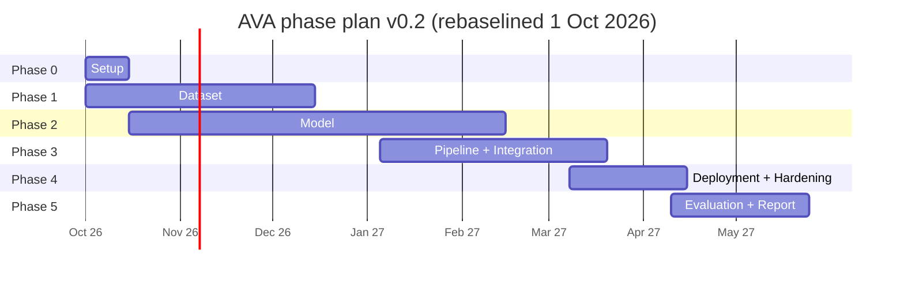
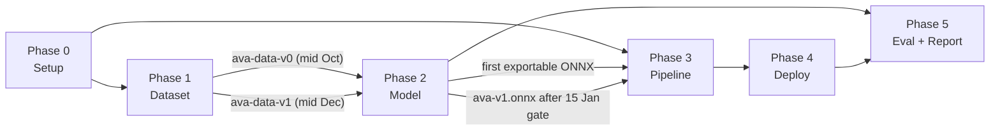

# AVA: Acoustic Veracity Analyzer — Product Requirements Document

Real-time audio deepfake detection for Urdu and Punjabi in bank and call-centre telephony.

| Field | Value |
|---|---|
| Version | 0.2 (draft) |
| Date | 2026-10-01 |
| Supersedes | v0.1 of 2026-09-04 |
| Source | Project Scope Document v1.0 (GIKI FCSE, BS Software Engineering); Research Update and Proposed Direction, 26 Sep 2026; Title Defence deck, 29 Sep 2026 |
| Team | Ayesha (2023143), Ibrahim (2023446), Ilsa (2023258), Tughral (2023532) |
| Supervisor | Prof. Dr. Ghulam Abbas |
| Co-Supervisor | Dr. Khurram Khan Jadoon |
| Companion | [architecture.md](architecture.md) v0.2; reconcile remaining cross-references before v1.0 freeze |
| Status | Draft for supervisor review |

---

## What this document asks of you

- **Supervisor:** sign off on the decisions in §4 (especially D4 model, D5 generators, D7 telephony path) and the provisional targets in §6; answer the two questions you own in §10 (Q2 PTCL, Q5 replay attacks); confirm who grants ethics approval (Q6).
- **Team:** assign a named owner to each workstream (§8) and each open question (§10) by 8 October; treat every P0 requirement as a GitHub issue.
- **Everyone:** this version replaces v0.1. Where the two disagree, this one is correct. Do not quote the old model, generator list, or compliance wording.

## Changes since v0.1

| Change | Why | Sections touched |
|---|---|---|
| Backbone is **AntiDeepfake MMS-300M** with an **SLS** head, 7 to 8 layers; XLS-R + SLS is the fallback; DuaBiMamba is dropped | Brief §5; deck slides 6 and 7. A model already post-trained for deepfake detection is a better start, and the Mamba head's gain does not justify its CPU and export cost | D4, A3, FR-M1, FR-M2, FR-M8, tasks 2.4 to 2.7, R1, R2, §11 |
| Generators are **OmniVoice, Seed-VC, RVC, MMS-TTS**, with **Fish Audio S2 held out**; XTTSv2 removed; ElevenLabs only with written permission | Brief §5 and §9: XTTSv2 supports neither language; ElevenLabs terms ban detector training | §1.1, D5, FR-D2, FR-D3, FR-D8, tasks 0.5, 1.4, R5 |
| Primary live-call path is the **Asterisk passive tap**; SIPREC becomes a stretch goal | Brief §5; deck slide 6. Asterisk has no SIPREC client | D7, FR-T1 to FR-T7, BO-4, tasks 0.7, 3.x, R4, Q3 |
| AMR-NB decoded in the **file path only**; live AMR-NB is P2 | Stock Asterisk cannot negotiate AMR-NB | A2, FR-I1, task 5.3 |
| Dataset is **~50,000 original clips** (3 to 6 s, ~60 h) from Common Voice Urdu, Meta Omnilingual Shahmukhi Punjabi, Habib University, CSALT-LUMS, UrduSpeech (rights pending) and **60 to 80 recorded speakers**; Common Voice pa-PK removed (it does not exist) | Brief §6; deck slide 8 | FR-D1, FR-D2, FR-D7, BO-2, task 1.2, R3, Q1 |
| **Fakes are made from the same consented speakers** who contribute genuine clips; pipeline parity and leakage probes are required | Brief §6.4 and §6.8; deck slide 8 | FR-D11, FR-D12, A4 |
| **Ethics approval, consent content, release policy, licence register, budget** added as requirements | Brief §10 and §11; none existed in v0.1 | FR-E1 to FR-E6, §8.3, R9, R11, Q6 |
| **Three research questions** (time-to-confidence, per-dialect false alarms, humans versus AVA) added as goals with requirements | Deck slide 9; brief §4 | RQ-A, RQ-B, RQ-C, FR-M9, FR-M10, FR-S1, tasks 2.x and 5.x |
| **Compliance wording corrected**: CTDISR-2025 binds telecom licensees and is motivation; the Personal Data Protection Bill is an unpassed draft | Brief §9 | §1.1, BO-5, §6.4, BO-5 evidence |
| **Metrics corrected**: min t-DCF replaced (needs a speaker-verification system AVA excludes); RTF defined; first-verdict arithmetic fixed; sample sizes and confidence intervals required | Review of v0.1 | FR-M5, §6.1, §6.2, task 5.3 |
| **Timeline rebaselined from 1 October 2026**; Phase 0 extended to 15 October | Phase 0 exit gate was unmet on its paper end date | §8 |
| Detailed decision rationale moved to Appendix A; decisions D5 to D15 given IDs; references and limitations added | Structure review | §4, §1.4, §12, Appendix A |
| **5 Oct 2026, project-owner decision:** public corpora whose licences permit derivative works (CSALT, Meta Omnilingual) may be used for voice cloning and training in this research under the university approval; Common Voice excluded from cloning pending its terms; participant cloning still needs the individual opt-in | Tughral, 5 Oct 2026 | D11, FR-D2, FR-D3, FR-D11, FR-E5, §6.4, Q1, R13, Appendix A |

---

## 1. Overview

### 1.1 Problem

Pakistan's banks, telecom operators and BPO call centres (1,000+ registered centres, $328M call-centre exports in FY2024-25 [14]) authenticate callers largely on assumed voice identity. Phone impersonation is already the country's leading fraud route: NCCIA reports 227,757 victims and Rs 8.32 billion lost in 2024 to 2026, mostly to callers posing as bank staff in their own voices [13]. Commodity voice cloning now works from about ten seconds of reference audio and supports Urdu, so a fraudster can go from pretending to be a role to sounding like a specific customer. Deepfake calls into contact centres rose from one every two days in 2023 to seven per day in 2024, a 1,337% increase, in US industry data [15]. No Pakistani voice-clone fraud case is documented yet; the motivation rests on the scale of phone impersonation and the maturity of the tools.

Existing detectors fail here for three reasons:

1. **Linguistic mismatch.** Models trained on English/Western phonetic baselines misread native Urdu/Punjabi phonetics and code-switching as vocoder artifacts. A standard detector evaluated on Urdu deepfakes scored about 50% error, chance level [6].
2. **Codec blindness.** GSM 06.10 and AMR-NB band-limit audio to under 4 kHz (8 kHz sample rate) and heavily compress it, destroying the high-frequency cues most detectors rely on. Narrowband codec conditions are the hardest in the ASVspoof benchmarks [4][5].
3. **Deployment mismatch.** Pindrop, Nuance Gatekeeper and similar platforms route audio through foreign cloud infrastructure and publish no results for Urdu or Punjabi. Pakistani telecom licensees must keep call data in-country under CTDISR-2025 [16], so a detector they can adopt has to run on their premises.

### 1.2 Product

AVA is an on-premises, CPU-only detection engine that passively receives a forked copy of live call audio, classifies each call as **genuine** or **AI-synthesized** in near real-time, and raises advisory alerts for human fraud analysts without touching the call path. It is trained on a purpose-built corpus of genuine and synthetic Urdu and Pakistani Punjabi speech degraded with realistic telephony codecs.

### 1.3 Vision

For banks and call centres in Pakistan handling high-stakes Urdu and Punjabi calls, AVA is a research prototype of an edge-deployable audio deepfake detector that identifies AI-synthesized speech in live telephonic sessions and generates immediate fraud alerts, without disrupting call traffic and without any foreign cloud dependency. Deployment inside a telecom operator's own network, where CTDISR-2025 applies directly, is future work.

### 1.4 Limitations

These are stated here, in the model card (FR-M12) and on the dashboard (FR-U1) so that nobody reads AVA as something it is not.

- AVA flags **likely synthetic speech**. An alert is not proof of fraudulent intent, and the absence of an alert does not verify the caller.
- AVA does **not** detect human impersonators speaking in their own voice, which is the majority of the fraud counted in §1.1.
- AVA does **not** verify identity. It is not a voice biometric.
- Targets in §6 are provisional until the first baseline run and will be revised in v0.3 with measured values.

---

## 2. Goals and non-goals

### 2.1 Objectives (from the scope document, plus additions marked)

| ID | Objective | Acceptance evidence (see §7) |
|---|---|---|
| BO-1 | Minimize EER on a held-out Urdu/Punjabi telephony test set, benchmarked against AASIST, RawNet2 and XLS-R+AASIST baselines trained on the same data | Evaluation report with EER, minDCF and FAR tables and confidence intervals |
| BO-2 | Build a representative genuine + synthetic Urdu and Pakistani Punjabi corpus with telephony codec augmentation, about 50,000 original clips | Datasheet, manifest, statistics |
| BO-3 | Deliver a near real-time streaming inference pipeline on CPU-only edge hardware via ONNX Runtime | Benchmark log on the reference box |
| BO-4 | Validate end-to-end on live calls through an Asterisk lab PBX with a passive audio tap | Recorded live demo; e2e test in CI |
| BO-5 | Architect for on-premises, zero-egress operation so a licensee bound by CTDISR-2025 could deploy it; align with the draft Personal Data Protection Bill's principles | Egress test with outbound network blocked |
| BO-6 | Demonstrate robustness on Standard Urdu and Majhi Punjabi, and measure false alarms on Pothwari, Saraiki and other dialects | Per-language and per-dialect tables |
| BO-7 | Package as Docker containers orchestrated by Kubernetes for portability across local edge hardware | Clean k3s deploy; docker compose for dev |
| BO-8 (added in PRD) | Analyst dashboard with live verdicts, a per-window timeline, alerts, and a batch upload mode | Demo |
| RQ-A (added) | **How fast can we be sure?** Report accuracy as a function of evidence length over GSM and AMR phone audio | Time-versus-accuracy curve per codec (FR-M9) |
| RQ-B (added) | **Does it wrongly accuse real speakers?** Report the false-alarm rate per dialect | Per-dialect FAR table with intervals (FR-M10) |
| RQ-C (added) | **Humans versus AVA.** Compare Pakistani listeners, AVA, and listeners helped by AVA on the same clips | Listening-study results (FR-S1) |

### 2.2 Non-goals (explicitly out of scope)

- Video, image or text deepfake detection.
- Sample-accurate splice localization or generator attribution (which tool made it). The per-window score timeline (2 s resolution) **is** in scope.
- Integration into live, production telecom networks (e.g. PTCL's active infrastructure).
- Detection for English or languages other than Urdu and Punjabi. Detection is trained on Standard Urdu and Majhi Punjabi; other Punjabi dialects are evaluated for false alarms, not optimized for.
- Speaker identification or biometric voice authentication. AVA detects synthesis artifacts, not identity. A caller-versus-enrolled-voice check is a stretch goal only (D15).
- Replay attack detection as a primary objective; it may be included in evaluation if time permits (Q5).
- Automatic call termination or any active intervention in the call path. AVA is passive and advisory.
- Public release of the dataset or model by default (FR-E4).

---

## 3. Users and stakeholders

### 3.1 Personas

| Persona | Description | Primary needs |
|---|---|---|
| **Fraud analyst** (primary end user) | Works in a bank or call-centre security team. Monitors multiple concurrent calls. | Clear real-time alerts, low false positives, context to act (call ID, agent, confidence trend, which seconds looked fake, optional audio snippet). |
| **Security operations lead** | Owns fraud KPIs and tooling. Configures thresholds and reviews history. | Tunable sensitivity, audit logs, exportable reports, integration hooks. |
| **Telecom / PBX engineer** | Deploys and maintains the system on-prem. | Simple container deployment, PBX tap configuration guidance, health metrics, no internet dependency. |
| **Compliance officer** | Ensures data-localization and privacy obligations are met. | Proof of data locality, retention controls, access logs. |
| **ML engineer** (project team) | Trains, evaluates, and exports models. | Reproducible data pipeline, evaluation harness, export tooling. |
| **Recorded speaker** (data subject) | Volunteers or is paid to record speech that is also used to make fakes. | Clear consent, anonymity, the right to withdraw, no public release without re-consent. |

### 3.2 Stakeholders

| Role | Stakeholder |
|---|---|
| Sponsor | GIKI |
| Evaluation | SDP Assessment Committee, FCSE |
| Ethics approval | GIKI ORIC or the body named by the FYP coordinator (Q6) |
| Prospective industry partner | PTCL or equivalent (subject to MOU, Q2) |
| Regulators (context only) | PTA, NCCIA |
| Data sources | Mozilla Common Voice (Urdu), Meta Omnilingual ASR Corpus (pnb_Arab), Habib University, CSALT-LUMS, UrduSpeech (rights pending), LDC (scholarship pending), team-recorded speakers |

---

## 4. Decisions and assumptions

One decision per row with its one-sentence reason. Appendix A carries the alternatives considered and the longer argument. Each ID is citable from issues, the SRS and the architecture.

| ID | Decision | Why, in one sentence |
|---|---|---|
| D1 | **Serving:** Python FastAPI service wrapping ONNX Runtime; REST for control and batch, WebSocket for live events; React dashboard | Keeps the API in the ML language so batch and live share one code path, and the live board needs push updates every 2 s. |
| D2 | **Batch mode is in scope** alongside live calls | A file is a call without the phone line; it costs little and lets us demo and evaluate without the PBX. |
| D3 | **Edge target is CPU-only.** No GPU at inference time; training may use GPUs under the data rule in D13 | Real call centres run ordinary servers; a GPU requirement would mean "buy new hardware". |
| D4 | **Model:** AntiDeepfake MMS-300M [2] post-trained weights, truncated to about 7 to 8 transformer layers chosen by a sweep, with an SLS (sensitive layer selection) classification head [3]; fallback is XLS-R 300M with the same SLS head | A model already post-trained on 74k hours of deepfake data in 100+ languages is a better starting point at no extra cost, and the field reports that progress now comes from data rather than new head designs [4]. |
| D5 | **Synthesis stack is fixed:** OmniVoice (zero-shot cloning, Urdu and Pakistani Punjabi), Seed-VC and RVC (voice conversion), MMS-TTS (TTS, Urdu; Punjabi subject to the smoke test), with **Fish Audio S2 held out** as the unseen tool; ElevenLabs is used only if written research permission is obtained (Q7) | Named tools give testable acceptance criteria; the four cover cloning, conversion and TTS; XTTSv2 supports neither language and ElevenLabs' terms ban detector training. |
| D6 | **Dataset target:** about 50,000 original clips of 3 to 6 s (about 60 h), roughly 45% genuine and 55% synthetic, split evenly between Urdu and Pakistani Punjabi; codec copies are not counted | "Diverse" cannot be checked; a clip count of originals can, and codec copies of one clip are not new data. |
| D7 | **Live-call ingestion:** Asterisk passive tap (ARI snoop channel plus ExternalMedia, or equivalent) delivering plain RTP to AVA is the primary path; a SIPREC Recording Server exercised through jambonz as the SIPREC client is a stretch goal | Asterisk has no SIPREC client, so the tap is the only path the lab can drive; SIPREC remains the production-equivalent interface. |
| D8 | **Codecs:** G.711 and GSM 06.10 are exercised live; AMR-NB is exercised on recorded files and replayed captures | Stock Asterisk cannot negotiate AMR-NB. |
| D9 | **Windows:** 4 s windows every 2 s of speech; a provisional verdict after the first window, a state change only after two | 4 s is the crop length detectors are trained on; 2 s keeps it live; two windows before any state change avoids greeting-phase alarms. |
| D10 | **Alerting:** EMA smoothing and a three-state machine with separate enter and exit thresholds, all in config | One noisy window must not flip an alarm on and off; the operating point is a business choice that differs between a bank and a BPO. |
| D11 | **Fakes come from the same speakers as genuine clips**, and both classes go through one processing script. Eligible target voices are consenting participants (FR-E2 opt-in) and, by project-owner decision of 5 October 2026 under the university approval, speakers in public corpora whose licences permit derivative works (CSALT CC BY-NC 4.0, Meta Omnilingual CC BY 4.0) | Otherwise the model can learn "this voice is real" or "this silence pattern is fake" instead of what synthesis sounds like. Using the public speakers on both sides removes the genuine-only shortcut for those corpora too. |
| D12 | **No raw audio retained by default**; alert snippets are opt-in, bounded and TTL-limited | Less stored voice data is less to protect and less to explain. |
| D13 | **Data locality rule:** raw and consented audio stay on university-controlled storage in Pakistan; rented GPUs may process public-licence data, or consented data only if the consent form names off-site processing and the provider region is in-country | One rule, enforceable, consistent with the privacy story. |
| D14 | **Dataset release policy:** no public release of audio or speaker-level manifests by default; internal and examiner access only; any later release needs re-consent | The consent form must say this from day one. |
| D15 | **Caller-versus-enrolled-voice check** is a stretch goal only | It matches real bank fraud but is a biometric with its own consent regime; out of scope unless everything else is done. |

| ID | Assumption | Rationale |
|---|---|---|
| A1 | Reference CPU box for all latency and throughput targets: **8 physical cores (16 threads), 32 GB RAM, x86-64 with AVX2 or AVX-512**; the exact CPU model and whether it supports VNNI are recorded in the benchmark log once task 0.8 completes | A latency target means nothing without the machine it is measured on. |
| A2 | Telephony audio arrives at **8 kHz, mono**, in G.711 μ-law or A-law, GSM 06.10, or AMR-NB; AVA upsamples to 16 kHz for the backbone through the same `ingest` module used in training | Matches Pakistani network codecs; identical conditioning avoids train/serve mismatch. |
| A3 | If the D4 model cannot meet the CPU budget after INT8 quantization and layer truncation, the fallback order is: fewer layers, then XLS-R 300M + SLS, then hop 2 s to 4 s, then concurrency target 8 to 4, then revise §6.1 with evidence by end of January 2027 | Naming the whole fallback ladder now means no step is a scope change. |
| A4 | **Speaker-disjoint splits** are mandatory, and each speaker's genuine and synthetic clips land in the same split | Prevents identity leakage inflating results. |
| A5 | The Phase 0 exit gate is reviewed on **15 October 2026**; the schedule in §8 is measured from 1 October 2026 | The v0.1 Phase 0 end date passed with its gate unmet. |

---

## 5. Functional requirements

Priorities: **P0** = must have for SDP completion, **P1** = should have, **P2** = nice to have. Every P0 requirement becomes a GitHub issue with a named owner.

### 5.1 Dataset (FR-D)

| ID | Requirement | Priority |
|---|---|---|
| FR-D1 | Collect genuine speech from: **Urdu**: Mozilla Common Voice Urdu (validated set, capped at 30 clips per speaker), UrduSpeech (only after a rights check, Q8), the CSALT-LUMS Urdu deepfake corpus (genuine partition, from its public GitHub release), and the Urdu part of team recording sessions. **Pakistani Punjabi**: Meta Omnilingual ASR Corpus pnb_Arab (Shahmukhi), the Habib University Punjabi corpus (subject to access, Q8), and team-recorded speakers (FR-D4). **Other dialects, test only**: Pothwari, Saraiki and Hindko from Common Voice and Meta Omnilingual. Each source's licence and permitted uses are recorded in the licence register (FR-E5). | P0 |
| FR-D2 | Generate synthetic speech for both languages with every training generator in D5. Target per language: about 12,000 synthetic clips across the training generators, plus about 1,500 clips from the held-out generator for test only. Target voices are drawn from the speakers permitted by FR-D11: consenting participants and public-corpus speakers (CSALT for Urdu, Meta Omnilingual for Punjabi). The manifest records tool, version, source speaker and prompt text for every synthetic clip. | P0 |
| FR-D3 | Include voice-conversion attacks (Seed-VC and RVC applied to genuine recordings, at least 10 target voices from FR-D11-permitted speakers), not only text-to-speech. Voice conversion is the main source of Punjabi fakes because it preserves the speaker's accent. | P0 |
| FR-D4 | Record **60 to 80 Pakistani Punjabi speakers**, about half women and half men, mostly Majhi with some from other regions, in sessions of 10 to 12 minutes: Part A read speech (20 to 30 sentences in Shahmukhi Punjabi and Urdu, some code-switched), Part B free speech (prompts that provoke natural code-switching), Part C a role-play call to a bank about a blocked card. Recording is over a real call into the Asterisk lab or with a web recorder that saves WAV; WhatsApp voice notes are not accepted. Each speaker gets an anonymous ID and a short demographic form (age band, gender, home district, dialect, languages, phone model). | P0 |
| FR-D5 | Include **code-switched** utterances (Urdu or Punjabi with embedded English) in both genuine and synthetic partitions, at least 15% of each. A clip is code-switched if its transcript (prompt text for TTS and recordings; the sentence field for public corpora) contains at least one English content word; the manifest carries a `code_switched` boolean set by this rule and spot-checked on 100 clips. | P0 |
| FR-D6 | Apply telephony augmentation to every clip: resample to 8 kHz, then encode and decode through G.711, GSM 06.10, AMR-NB (4.75, 7.4, 12.2 kbps) and a VoIP path (Opus at 8 to 16 kbps or G.729), with randomized packet loss (0 to 5%) and jitter. The chain is recorded per clip. Codec copies are stored but not counted toward D6's clip total. | P0 |
| FR-D7 | Add environmental augmentation: additive noise (call-centre babble, street, vehicle) at 0 to 20 dB SNR, and room impulse responses for handset and speakerphone. | P1 |
| FR-D8 | Produce **speaker-disjoint** 70/10/20 train/dev/test splits with a manifest (CSV or JSONL) recording clip ID, speaker ID, language, dialect, genuine/synthetic, generator, source clip, prompt, codec chain, SNR, duration, split and licence. A script asserts zero speaker overlap and that each speaker's genuine and synthetic clips share a split. Test partitions: (a) in-domain, (b) held-out generator, (c) held-out dialects (Pothwari, Saraiki, Hindko, and any dialect with too few speakers for training), (d) real phone-call genuine set (LDC2017S14 if the scholarship is granted, otherwise lab call recordings). | P0 |
| FR-D9 | Hold out **Fish Audio S2** entirely from train and dev as the unseen-attack partition. The held-out generator must produce intelligible speech in both languages (checked in the Phase 0 smoke test) and must be absent from the documented training sources of the D4 checkpoint; if either check fails, a different generator is held out and the choice is recorded. | P0 |
| FR-D10 | Document the dataset in a datasheet: sources, consent, licences, speaker and dialect statistics, generator statistics, codec statistics, known gaps. | P0 |
| FR-D11 | **Same-speaker rule.** Every synthetic clip's target voice is a speaker who also contributes genuine clips, from one of two permitted pools: (a) participants who ticked the separate cloning box (FR-E2); (b) speakers in public corpora whose licence permits derivative works, used under the university approval reported on 4 October 2026 by project-owner decision of 5 October 2026: CSALT Urdu (CC BY-NC 4.0, noncommercial research only) and Meta Omnilingual pnb_Arab (CC BY 4.0, with attribution). Common Voice is excluded from cloning until its no-reidentification and no-resharing terms are reviewed. TTS and cloning tools are prompted with that speaker's reference audio; stock voices are not used. Participants who consent to recording but not to cloning contribute genuine audio to the test split only. Public-corpus genuine and synthetic clips are training-eligible under this decision; the licence register (FR-E5) records the basis, and no cloned public voice is released (D14). | P0 |
| FR-D12 | **Pipeline parity and leakage control.** Genuine and synthetic clips pass through one script: trim silence, cut to 3 to 6 s, loudness-normalize, resample, codec chain, quality checks, manifest row. Per-partition distributions of duration, leading and trailing silence and loudness are reported and must overlap. Two leakage probes, a silence-only classifier and a duration-only classifier, are trained and must score near 50% EER. | P0 |
| FR-D13 | **Quality checks** on every clip: length, silence ratio, loudness, a noise score, a language check that it is Urdu or Punjabi; synthetic clips also get an ASR check that the words came out right. Established research corpora such as CSALT retain their published class/language labels for intake, with source/version provenance and automated integrity/audio checks; individual human listening approval is not an ingestion gate. The team listens to a random 5% of each batch and targets suspicious derived outputs; if more than 10% of the listening sample fails, the whole batch is re-checked. Source acceptance does not imply that newly cut/processed clips have passed listening QA. | P0 |
| FR-D14 | Versions: `ava-data-v0` (public data only plus the first synthetic batch, early October) so model work starts immediately; `ava-data-v1` (adds team recordings and their fakes, mid-December). | P0 |
| FR-D15 | Phase 0 **generator smoke test**: 20 Punjabi and 20 code-switched prompts per tool in D5, listened to and scored for intelligibility and language correctness, with a pass/fail rule and a named owner. A tool that fails on a language is not used for that language. | P0 |

### 5.2 Ethics and data governance (FR-E)

| ID | Requirement | Priority |
|---|---|---|
| FR-E1 | **Ethics approval** from GIKI ORIC, or the body the FYP coordinator names (Q6), is obtained before the first recording session. The approval reference is recorded in the datasheet. The application covers recording, voice cloning, and the listening study (FR-S1). | P0 |
| FR-E2 | **Consent form** signed before recording, stating: what is recorded and why; a separate tick-box for cloning the speaker's voice; storage location and deletion date; the right to withdraw, with deletion of the speaker's clips and every fake made from them; separate tick-boxes for internal use, sharing with examiners, and public release; off-site processing if D13 permits it; payment terms; "voluntary, no effect on grades". Forms are stored offline, separately from audio, linked only by speaker ID. | P0 |
| FR-E3 | **Data locality** per D13. Raw audio, consent forms and speaker-level manifests live on university-controlled storage or an encrypted drive with one backup, never in any repository. | P0 |
| FR-E4 | **Release policy** per D14: no public release of audio, speaker-level manifests or models trained on consented voices by default. | P0 |
| FR-E5 | **Licence register** covering every pretrained weight, generator, corpus and tool, stating permitted uses (train, voice cloning as a derivative work, redistribute data, redistribute model, commercial) and, for cloning, the approval basis. The datasheet and model card carry the resulting restriction (expected: research and non-commercial use only, since MMS-derived weights and MMS-TTS are CC-BY-NC). | P0 |
| FR-E6 | **Repository guard.** The public repository never contains audio, consent forms, personal manifests or model checkpoints trained on consented voices; enforced by `.gitignore`, a pre-commit hook blocking audio extensions and files over 1 MB, and a CI check. | P0 |

### 5.3 Detection model (FR-M)

| ID | Requirement | Priority |
|---|---|---|
| FR-M1 | Backbone: AntiDeepfake MMS-300M post-trained weights (D4), converted to a Hugging Face or ONNX-exportable format if needed, truncated to the layer count chosen in task 2.4 (sweep over 4, 6, 7, 8, 10, 12 kept layers), fine-tuned on `ava-data-v1`. | P0 |
| FR-M2 | Classification head: SLS (sensitive layer selection) over the retained layers' hidden states, feeding a small classifier. The layer sweep is run with the SLS head, not a placeholder. | P0 |
| FR-M3 | Output: per-window synthesis probability in [0, 1] plus a 256-d embedding, with calibration applied (FR-M6). | P0 |
| FR-M4 | Train and report three baselines on the same manifests, augmentation and splits: AASIST, RawNet2 (raw-waveform) and XLS-R + AASIST with RawBoost (SSL baseline). | P0 |
| FR-M5 | Report EER, minDCF (ASVspoof 5 DF-track cost) and FAR at the operating point where FRR = 5%, each with 95% bootstrap confidence intervals, on: (a) full test set, (b) per language, (c) per codec, (d) held-out generator partition, (e) code-switched subset, (f) held-out dialects, (g) real phone-call set. | P0 |
| FR-M6 | Score calibration (temperature scaling) on the dev set; Expected Calibration Error at or below 0.05; reliability diagram in the evaluation report. | P0 |
| FR-M7 | Export to ONNX (opset 17, static 64,000-sample input, dynamic batch), validate numerical parity with PyTorch (max abs logit diff below 1e-3 on 100 windows), apply INT8 dynamic quantization, and re-measure dev EER. If INT8 loses more than 0.3 EER points, try static quantization, then ship FP32 with latency re-benchmarked. | P0 |
| FR-M8 | Ablation: SLS head versus mean-pool + MLP head on the same truncated backbone, to justify the head. | P1 |
| FR-M9 | **RQ-A.** Report EER and FAR as a function of evidence length (1, 2, 3, 4 and 6 windows of speech) per codec (G.711 and GSM live; AMR-NB on files), as a curve with intervals. The minimum-evidence rule N in FR-I5 is chosen from this curve and the chosen point is recorded. | P0 |
| FR-M10 | **RQ-B.** Report FAR at the deployed operating point per dialect (Majhi, Pothwari, Saraiki, Hindko, Standard Urdu, code-switched) on dialect-held-out genuine sets. A dialect is reported only if it has at least 10 speakers and 500 genuine clips; otherwise it is listed as "insufficient data". | P0 |
| FR-M11 | Offline evaluation scores one zero-padded window per clip (clips are 3 to 6 s). The minimum-evidence rule is evaluated only on the live-call campaign and on concatenated clips of at least 8 s. | P0 |
| FR-M12 | Model card documenting training data, metrics, known failure modes, the licence restriction from FR-E5, and the limitation text from §1.4. | P0 |

### 5.4 Streaming inference pipeline (FR-I)

| ID | Requirement | Priority |
|---|---|---|
| FR-I1 | Accept forked RTP audio per call and decode G.711 μ-law and A-law and GSM 06.10 live. Decode AMR-NB (all eight modes, mode switching, SID/DTX, both RFC 4867 payload formats) in the file path and from replayed RTP captures; live AMR-NB is P2 and depends on an Asterisk AMR module. SDP offers with only unsupported codecs are rejected and logged; comfort-noise and telephone-event payloads are ignored. | P0 |
| FR-I2 | Maintain a jitter buffer and reassemble audio in order; tolerate up to 5% packet loss with concealment. A window with more than 10% concealed samples is not scored and the call shows `quality=low`; sustained loss above 5% emits a `system.health` event. | P0 |
| FR-I3 | Resample to 16 kHz with the shared `ingest` module and apply voice activity detection; windows are built over speech only, scored when at least 2.5 s is speech; a tail shorter than a window at call end is zero-padded and marked partial. A call with no detected speech shows `state=no_speech`. | P0 |
| FR-I4 | Score sliding windows of 4 s with a 2 s hop (configurable). Configuration is validated: 0 < exit < enter ≤ 1, 0 < hop ≤ window, window equals the model card's window. Reloads apply to calls started after the reload. | P0 |
| FR-I5 | Aggregate window scores per call with an exponential moving average and a minimum-evidence rule: a provisional score after the first window; no state change until N windows (default 2, set from FR-M9). A call or file that ends with fewer than N speech windows reports `verdict=undetermined`, never genuine. | P0 |
| FR-I6 | Emit a provisional verdict within **6 s of speech onset plus the p95 window latency** (target ≤ 7.5 s on the reference box) and update at each hop. The target applies only when not in degraded mode; `score.updated` carries the degraded flag and effective stride. | P0 |
| FR-I7 | Alert state machine with hysteresis: `monitoring → suspicious → alert` with separate enter and exit thresholds. All transitions are defined, including `alert → suspicious`, `suspicious → monitoring`, and re-alert after clearing; each `alert.raised` gets a new alert ID. A call that ends in `suspicious` or `alert` persists its final state and the alert is listed as `ended_open`. | P0 |
| FR-I8 | Score only the caller direction by default. Agent-direction scoring is configurable, starts only after a human agent answers (IVR prompts excluded), and when enabled the call state is the more severe of the two directions with the driving direction shown. On the tap path the agent direction needs a second snoop channel and is P2. "Caller" means the remote party by call direction, not SIP From. | P1 |
| FR-I9 | Handle at least 8 concurrent calls on the reference box within latency targets. Above the configured maximum, new sessions are refused with a `system.health` event while the call itself continues. Batch jobs use at most 25% of inference capacity while live calls are active. | P0 |
| FR-I10 | Degrade gracefully: if inference falls behind, increase stride rather than queue unboundedly; cap the stride at 4× hop, beyond which the call shows `state=unmonitored`; clear degraded mode only after 30 s under budget. | P1 |
| FR-I11 | Call cleanup drains or cancels in-flight windows; late results for an unknown call ID are discarded. Scores and state are flushed to PostgreSQL every hop so a scorer restart resumes from persisted state. | P0 |

### 5.5 Telephony integration (FR-T)

| ID | Requirement | Priority |
|---|---|---|
| FR-T1 | Provide a simulated telephony lab: Asterisk PBX, two or more SIP softphone endpoints, and a call generator (SIPp or scripted originations) that can play genuine and synthetic audio files into calls, with codec forcing for G.711 and GSM. | P0 |
| FR-T2 | **Passive tap (primary).** An ARI application attaches a snoop channel to each call and streams the caller direction as plain RTP (ExternalMedia or equivalent) to AVA. Call start and end come from ARI events (StasisStart, StasisEnd or ChannelHangupRequest); call ID, from and to come from ARI channel fields. A tap socket with no packets for 30 s is torn down with `call.ended reason=timeout`. | P0 |
| FR-T3 | Map tapped sessions to call metadata (call ID, from, to, timestamps, codec) and expose it to the dashboard. | P0 |
| FR-T4 | AVA must never be in the media path; failure of AVA must not affect the call. The deployment guide requires the PBX's recording-failure policy to be "continue the call", and the e2e test asserts a call survives AVA being stopped. | P0 |
| FR-T5 | Support session teardown and cleanup of all per-call state within 5 s of the end event. | P0 |
| FR-T6 | **SIPREC (stretch).** A SIPREC Recording Server (RFC 7865/7866) that accepts INVITEs, parses metadata, negotiates SDP and receives two forked streams, exercised with jambonz as the SIPREC client. Shares the RTP receiver with FR-T2. | P2 |
| FR-T7 | If neither the snoop tap nor ExternalMedia delivers forked RTP in the Phase 0 spike, the fallback is MixMonitor or chan_spy to a named pipe, then FreeSWITCH; if all fail, Phase 3 starts batch-only and FR-T2 drops to P1 with a dated review. | P0 |

### 5.6 API and batch mode (FR-A)

| ID | Requirement | Priority |
|---|---|---|
| FR-A1 | `POST /v1/analyze` accepts a WAV, MP3, AMR or GSM file up to 10 minutes and 100 MB; returns overall verdict, confidence, per-window timeline, language hint, codec detected and processing time. Rejects oversize with 413 and undecodable with 422; downmixes stereo; resamples any input to 8 kHz and then through the shared `ingest` path; wideband sources are flagged `out_of_domain`. Synchronous for files up to 60 s; longer files return 202 with a job ID. | P0 |
| FR-A2 | `GET /v1/jobs/{id}` returns `queued`, `running`, `done` or `failed` with the result when done. | P0 |
| FR-A3 | `GET /v1/calls` and `GET /v1/calls/{id}` list active and historical calls with state, score trend and alerts; in-memory timelines keep the last 30 minutes at full resolution and downsample older points, with full history in PostgreSQL. | P0 |
| FR-A4 | `WS /v1/events` streams `call.started`, `score.updated`, `alert.raised`, `alert.cleared`, `call.ended` (with final state and reason), `system.health`. | P0 |
| FR-A5 | A language-identification stage produces the language hint; if the language is not Urdu or Punjabi the verdict is marked `out_of_domain` and no alert is raised. | P1 |
| FR-A6 | `GET /v1/alerts` with filters (time range, state, minimum confidence) and CSV export. | P1 |
| FR-A7 | `POST /v1/alerts/{id}/feedback` lets analysts mark true or false positive; stores the label with per-window scores and embeddings. Retraining from feedback requires snippet retention to be on and is documented as such. | P1 |
| FR-A8 | `GET /healthz`, `GET /readyz` (performs a warm-up inference), `GET /metrics` (Prometheus format). | P0 |
| FR-A9 | Configuration endpoint, or config file plus reload, for thresholds, window, hop and direction selection, validated per FR-I4. Without FR-U7 the endpoint is disabled and only file plus reload is available. | P1 |
| FR-A10 | Optional outbound webhook on `alert.raised` to an on-prem endpoint, disabled by default; when enabled, the network policy adds one egress rule to that host and port only; delivery is retried three times and failures are logged. | P2 |
| FR-A11 | OpenAPI 3 specification auto-generated and served at `/docs`. | P0 |

### 5.7 Analyst dashboard (FR-U)

| ID | Requirement | Priority |
|---|---|---|
| FR-U1 | Live call board: one card per active call with call ID, duration, state (`monitoring`, `suspicious`, `alert`, `no_speech`, `unmonitored`), confidence, a sparkline of score over time, the quality and degraded flags, and the limitation text from §1.4 visible in the interface. | P0 |
| FR-U2 | Alert feed with sound and visual notification on new alerts. | P0 |
| FR-U3 | Per-window score timeline for every call and file, highlighting which seconds scored as synthetic (2 s resolution). | P0 |
| FR-U4 | Batch upload page: drag-and-drop file, poll the job, show verdict and timeline. | P0 |
| FR-U5 | Call detail view with codec detected and playback of retained snippets if retention is on; an expired or missing snippet shows a clear message. | P1 |
| FR-U6 | History and search over past calls and alerts. | P1 |
| FR-U7 | Login with username and password; two roles: `analyst` (read, feedback) and `admin` (settings); settings page for thresholds and retention. | P1 |
| FR-U8 | Works offline: no CDN fonts, scripts or telemetry; all assets bundled. | P0 |

### 5.8 Listening study (FR-S)

| ID | Requirement | Priority |
|---|---|---|
| FR-S1 | **RQ-C.** A listening study with at least 30 Pakistani participants, 40 balanced clips (speaker-disjoint from training, reserved in Phase 1), three conditions: listeners alone, AVA alone, listeners shown AVA's score. Report accuracy per condition with intervals. Protocol and consent are covered by FR-E1. | P1 |

### 5.9 Deployment and operations (FR-O)

| ID | Requirement | Priority |
|---|---|---|
| FR-O1 | Every service ships as a Docker image from a reproducible Dockerfile; a `docker compose` file gives a one-command developer setup. | P0 |
| FR-O2 | Kubernetes manifests (k3s single node for the demo) deploy all services with health probes, resource limits and persistent volumes. | P0 |
| FR-O3 | Kubernetes `NetworkPolicy` denies all egress from AVA pods except to in-cluster services and the PBX network; a CI test runs the stack with outbound DNS and HTTP blocked and asserts the e2e test still passes. | P0 |
| FR-O4 | Model artifacts load from a local volume; no model download at runtime; startup fails loudly if a model or its card is missing or disagrees with config. | P0 |
| FR-O5 | Configurable audio retention: default **no raw audio stored**. When on: a 30 s ring buffer per scored direction, one snippet per alert ID persisted at `alert.raised`, AES-256-GCM at rest, TTL cleanup (default 7 days); toggling applies to calls started after the change; switching off purges existing snippets within one cleanup run; write failures never block the alert. | P0 |
| FR-O6 | Structured JSON logs; Prometheus metrics (latency per stage, queue depth, active calls, alerts per minute, dropped windows); Grafana dashboard. | P1 |
| FR-O7 | Images pinned by digest; hashed pip requirements; SBOM generated in CI. | P1 |
| FR-O8 | Deployment guide covering hardware, PBX tap configuration, the recording-failure policy (FR-T4), upgrade, backup, and the security controls in §6.3. | P0 |

---

### 5.10 Development workflow and context continuity (FR-W)

Added 2 October 2026 at the team's request. These are construction requirements,
not claims that the product or research targets have been achieved.

| ID | Requirement | Priority |
|---|---|---|
| FR-W1 | Claude Code and Codex use common repository instructions, canonical BMAD planning documents and a versioned current-state record. Update the PRD for requirement changes and shared context for verified progress; retain stable requirement IDs and explicit assumptions. | P0 |
| FR-W2 | Substantive test-case design uses GPT-6 Astra with actual model provenance. Browser testing and bounded authorized-origin crawling use Playwright. Data, model and telephony acceptance use the appropriate additional test layers; fixture tests do not establish product acceptance. | P0 |
| FR-W3 | Simultaneous coding clients use separate worktrees/branches with explicit file ownership. One coordinator integrates shared document changes; workers produce individual handoffs. Integrate and test the combined changes before declaring a gate passed. | P0 |
| FR-W4 | Maintain portable role descriptions, generated native agent adapters, BMAD skill availability for both clients, setup commands, a context export and automated drift/repository checks. No paid assistant account is required to execute project tests. Preserve data governance in every export and artifact. | P0 |

Implementation status and test evidence are recorded in
[current state](../../docs/context/current-state.md), not inferred from the existence
of role descriptions or CI configuration. The workflow is specified in
[engineering workflow](../../docs/engineering/workflow.md).

Pilot implementation note (3 October 2026): `data/prepare/prepare_audio.py`
provides partial FR-D8/FR-D12/FR-D13 groundwork: immutable source verification,
explicit native PCM16 to 16 kHz mono conversion with soxr HQ, pause-based candidate
segmentation, per-candidate −3 dBFS sample-peak normalization, lineage, signal flags
and uncovered ranges. Canonicalization precedes pause proposals; gain follows cuts.
This source pilot is not the complete FR-D12 pipeline: trimming, language/ASR/noise
checks, listening QA, synthetic lineage, telephone-domain conversion and codecs,
train/serve parity, leakage probes and dataset acceptance remain outstanding.
Measured results remain in the current-state record above.

CPU baseline note (4 October 2026): `models/smoke/antideepfake.py` executes the
pinned official AntiDeepfake MMS-300M weights and original trained linear head
on local prepared audio. A small genuine/existing-synthetic smoke run establishes
CPU execution and loading coverage only. It does not complete SLS-head training,
ONNX conversion, cross-framework parity, language/telephone evaluation or capacity
acceptance; these requirements remain unchanged.

## 6. Non-functional requirements

### 6.1 Performance (reference box A1, CPU-only)

Definitions: **RTF** (real-time factor) is inference seconds per second of audio for a single worker with 4 threads at batch 1, so per-window latency equals RTF × 4 s. Targets are provisional until the first benchmark (task 2.11) and will be revised with evidence.

| Metric | Target | Stretch |
|---|---|---|
| Per-window inference latency (4 s window, INT8 ONNX, 4 threads, batch 1), p95 | ≤ 1.5 s | ≤ 0.8 s |
| RTF per call (same conditions) | ≤ 0.375 | ≤ 0.2 |
| Time to first provisional verdict from speech onset (not degraded) | ≤ 6 s of speech + p95 latency (≤ 7.5 s) | ≤ 4 s + p95 |
| Verdict update cadence | every 2 s of speech | — |
| Concurrent calls per reference box (with micro-batching) | ≥ 8 | ≥ 16 |
| Batch: 60 s file end-to-end (batch size 8, 16 threads) | ≤ 10 s | ≤ 5 s |
| Memory per inference worker | ≤ 2 GB | — |
| Dashboard event latency (score emitted to UI) | ≤ 500 ms | — |

### 6.2 Detection quality

Every number is reported with a 95% bootstrap confidence interval. Gap targets are met when the interval of the gap includes the target.

| Metric | Target |
|---|---|
| EER on the full held-out telephony test set | ≤ 5% (stretch ≤ 3%) |
| EER on the held-out-generator partition | ≤ 12% |
| EER on the code-switched subset | within 2 points of the full-set EER |
| EER gap between Urdu and Punjabi | ≤ 2 points |
| AVA versus best baseline (AASIST, RawNet2, XLS-R+AASIST) | AVA EER ≤ best baseline EER on the telephony set and on the held-out-generator partition, with non-overlapping intervals; otherwise reported and explained |
| False alert rate at the operating point in the live lab | ≤ 3% of genuine calls, measured on at least 100 genuine and 100 synthetic calls per live codec |
| Per-dialect FAR (RQ-B) | Reported with intervals for every dialect meeting the FR-M10 floor; no target, the measurement is the contribution |
| Expected Calibration Error on dev after temperature scaling | ≤ 0.05 |

Targets are provisional until the first baseline run; they will be revised in v0.3 with evidence.

### 6.3 Security and privacy

- No network egress from inference, ingestion or storage services (enforced by NetworkPolicy and verified by test).
- TLS between dashboard and API. SIP-TLS and SRTP apply only if FR-T6 is built and are P2.
- Secrets via Kubernetes Secrets; no credentials in images.
- Audio is processed in memory and discarded by default; retention is opt-in, bounded and TTL-enforced (FR-O5).
- Role-based access and an audit log for logins, setting changes, feedback and exports, if FR-U7 is delivered; otherwise settings are file-only and the audit log records `actor=system`.
- No third-party analytics, fonts or telemetry in any component.
- Raw audio, consent forms and speaker-level manifests never enter a repository (FR-E6).

### 6.4 Regulatory motivation and design alignment

AVA is a research prototype. These regulations do not bind the project; they bind the organizations that would deploy it, and they explain the design choices. No telecom licensee takes part in the project, so CTDISR-2025 imposes no obligation on the team or its data handling; the on-premises design exists so that a licensee could adopt the result.

| Instrument | What it requires of a deployer | AVA design response |
|---|---|---|
| CTDISR-2025 (PTA, notified 29 Oct 2025) [16] | Telecom licensees keep critical telecom data, including call data, inside Pakistan; protect critical infrastructure | Fully on-premises; egress denied and tested; models bundled; passive tap so PBX is unaffected by AVA failure |
| Draft Personal Data Protection Bill (unpassed) | Purpose limitation, data minimization, consent, access control, accountability | No raw audio retained by default; consent with cloning opt-in; RBAC and audit log (FR-U7); release policy (D14) |
| HEC research-ethics requirements | Institutional review for human-subjects research | Ethics approval before recording (FR-E1) |

### 6.5 Reliability and maintainability

- Any single service restart must not lose in-progress call state: scores and state flush to PostgreSQL every hop (FR-I11); in-flight windows may be dropped.
- Code coverage ≥ 70% on ingestion, scoring and API modules; an end-to-end test that plays a known synthetic file through Asterisk and asserts an alert, and a genuine file and asserts none.
- Reproducible training: pinned dependencies, seeded runs, config-as-code, local MLflow tracking.
- Reproducible dataset: all collection, generation and processing scripts in the repository's `data/` folder; the dataset can be rebuilt from sources and the manifest.

### 6.6 Usability

- An analyst can identify a flagged call and its confidence within 3 seconds of glancing at the live board.
- The dashboard renders correctly at 1366×768 and 1920×1080.

---

## 7. Acceptance criteria by objective

| Objective | Acceptance evidence |
|---|---|
| BO-1 | Evaluation report with EER, minDCF and FAR tables and intervals for AVA, AASIST, RawNet2 and XLS-R+AASIST on the identical test set; §6.2 targets met or the gap explained. |
| BO-2 | Datasheet, manifest and statistics: about 11,000 genuine and 12,000 synthetic original clips per language plus the held-out partition; every D5 training generator represented; 60 to 80 recorded Punjabi speakers; zero speaker overlap across splits, checked by script. |
| BO-3 | Benchmark log on the reference box showing §6.1 latency and concurrency with the INT8 ONNX model, with the CPU model named. |
| BO-4 | Recorded demo: a call placed through Asterisk, tapped audio received, live verdict and timeline on the dashboard; e2e test passes in CI. |
| BO-5 | Egress test passes with all outbound connections blocked; §6.4 alignment table reviewed by the supervisor. |
| BO-6 | Per-language EER table for Urdu and Majhi Punjabi within the §6.2 gap; per-dialect FAR table (FR-M10). |
| BO-7 | `kubectl apply` on a clean k3s node brings up the full stack; `docker compose up` works for development. |
| BO-8 | Live board, timeline, alert feed and batch upload shown in the demo. |
| RQ-A | Time-versus-accuracy curve per codec in the evaluation report (FR-M9). |
| RQ-B | Per-dialect FAR table with intervals (FR-M10). |
| RQ-C | Listening-study results per condition (FR-S1), or a documented reason it was not run. |

---

## 8. Phased work breakdown

Six phases, measured from 1 October 2026. Four workstreams run through them, one per team member; **owners are to be named by 8 October (Q9)**.

| Workstream | Scope |
|---|---|
| **WS-A Data** | Corpus collection, recordings, consent, synthesis, augmentation, manifests, datasheet, listening study |
| **WS-B Model** | Baselines, AVA model, evaluation, calibration, export, quantization, benchmarking |
| **WS-C Telephony + Pipeline** | Asterisk lab, tap, ingest, scorer, streaming inference, SIPREC stretch |
| **WS-D API + Dashboard + Deployment** | FastAPI, WebSocket, React dashboard, batch mode, Docker and k3s, observability, egress evidence |

### Phase 0: Setup (1 to 15 October 2026)

| # | Task | Workstream | Satisfies |
|---|---|---|---|
| 0.1 | Repository with issue-driven workflow, CI skeleton (lint, unit tests), pre-commit audio guard | WS-D | §6.5, FR-E6 |
| 0.2 | Developer environment: Python 3.11, ffmpeg with libgsm, opencore-amr and opus, `docker compose` skeleton | WS-D | FR-O1 |
| 0.3 | Supervisor review of this PRD v0.2; architecture.md ADRs revised to match (ADR-1, 2, 4, 10, 11); freeze v1.0 of both only after both agree | All | — |
| 0.4 | Ethics application to ORIC (or the named body); consent form drafted per FR-E2; data-handling and release policy written | WS-A | FR-E1, FR-E2, FR-E4, Q6 |
| 0.5 | Public data download: Common Voice Urdu, Meta Omnilingual pnb_Arab, CSALT-LUMS; rights requests to UrduSpeech and Habib University; licence register started | WS-A | FR-D1, FR-E5, Q8 |
| 0.6 | Generator setup and smoke test: OmniVoice, Seed-VC, RVC, MMS-TTS, Fish Audio S2 on 20 Punjabi and 20 code-switched prompts each; ElevenLabs permission email sent | WS-A | FR-D15, D5, Q7 |
| 0.7 | AntiDeepfake MMS-300M checkpoint obtained, licence recorded, converted to an exportable format; a dummy forward pass runs on CPU | WS-B | FR-M1, R2 |
| 0.8 | Training compute decision (lab GPU or rented, under D13) | WS-B | Q4 |
| 0.9 | Asterisk version chosen; spike: snoop + ExternalMedia tap delivers caller RTP to a test listener; if not, FR-T7 fallbacks tried in order | WS-C | FR-T2, FR-T7, Q3 |
| 0.10 | Reference CPU box identified, CPU model and flags recorded, benchmarked with a dummy ONNX model | WS-B | A1 |
| 0.11 | Budget confirmed for speaker payments and tooling (§8.3); workstream owners named | All | §8.3, Q9 |

**Exit gate (reviewed 15 October).** Ethics application submitted; consent form reviewed by supervisor; at least one genuine corpus per language downloaded; every D5 generator passes the smoke test for at least one language and Fish Audio S2 for both; checkpoint runs on CPU; tap spike delivers forked RTP; reference box available; owners named.

### Phase 1: Dataset (1 October to 15 December 2026)

| # | Task | Workstream | Satisfies |
|---|---|---|---|
| 1.1 | Ingest public corpora; normalize to 16 kHz mono WAV; capture speaker IDs, dialect and licences in a raw manifest; cap Common Voice at 30 clips per speaker | WS-A | FR-D1 |
| 1.2 | `ava-data-v0`: public data plus the first synthetic batch, released by mid-October so WS-B can start | WS-A | FR-D14 |
| 1.3 | Text prompt sets in Urdu and Shahmukhi Punjabi, including code-switched sentences, for TTS, cloning and the recording sessions | WS-A | FR-D2, FR-D5 |
| 1.4 | Recruit 60 to 80 Punjabi speakers (families, GIKI and Lahore student societies, community contacts); schedule sessions after ethics approval | WS-A | FR-D4, FR-E1 |
| 1.5 | Recording sessions per FR-D4 (October to November), over the Asterisk lab or the web recorder; consent and demographic forms stored offline | WS-A + WS-C | FR-D4, FR-E2, FR-E3 |
| 1.6 | Synthetic generation as recordings arrive: OmniVoice cloning from each consented speaker's reference audio; Seed-VC and RVC conversion from genuine recordings; MMS-TTS for Urdu volume; Fish Audio S2 test-only batch | WS-A | FR-D2, FR-D3, FR-D9, FR-D11 |
| 1.7 | One processing script for both classes: trim, cut to 3 to 6 s, loudness, resample, codec chains with packet loss and jitter, quality checks, manifest row | WS-A + WS-C | FR-D6, FR-D12, FR-D13 |
| 1.8 | Environmental augmentation: noise at 0 to 20 dB SNR, handset and speakerphone RIRs | WS-A | FR-D7 |
| 1.9 | Shared conditioning module (`ingest`): resample 8 to 16 kHz with soxr, peak-normalize; used identically by augmentation and runtime | WS-C | A2, FR-I3 |
| 1.10 | Speaker-disjoint 70/10/20 split with same-speaker assertion; held-out generator, held-out dialect and real-call test partitions; leakage probes | WS-A | FR-D8, FR-D9, FR-D12, A4 |
| 1.11 | Reserve a 40-clip speaker-disjoint stimulus set for the listening study | WS-A | FR-S1 |
| 1.12 | Dataset statistics and datasheet; licence register completed | WS-A | FR-D10, FR-E5 |
| 1.13 | Data-handling audit: no consented audio sent to any external service without consent; all raw audio on controlled storage; repository guard passing | WS-A | FR-E3, FR-E6 |

**Deliverables.** `ava-data-v0` (mid-October) and `ava-data-v1` (mid-December); manifests; scripts; datasheet; statistics.

**Exit gate.** About 11,000 genuine and 12,000 synthetic original clips per language, with the shortfall reported honestly if Punjabi genuine falls short (floor: 8,000 genuine Punjabi clips with the gap explained); every D5 training generator represented; held-out partition present for both languages; zero speaker overlap; leakage probes near 50% EER; datasheet reviewed by supervisor.

### Phase 2: Model (15 October 2026 to 15 February 2027)

| # | Task | Workstream | Satisfies |
|---|---|---|---|
| 2.1 | Training harness: PyTorch + HF Transformers, config-as-code, seeded runs, local MLflow | WS-B | §6.5 |
| 2.2 | Evaluation harness: EER, minDCF, FAR at FRR = 5%, bootstrap intervals, all FR-M5 subsets, ECE | WS-B | FR-M5, FR-M6 |
| 2.3 | Train and evaluate AASIST, RawNet2 and XLS-R+AASIST+RawBoost on `ava-data-v0` then `v1` | WS-B | FR-M4 |
| 2.4 | Layer sweep on AntiDeepfake MMS-300M with the SLS head: keep 4, 6, 7, 8, 10, 12 layers; pick the cut from accuracy versus CPU cost | WS-B | FR-M1, FR-M2, A3, R1 |
| 2.5 | Fine-tune AVA (truncated backbone + SLS) with codec, noise and RawBoost augmentation; tune schedule and loss | WS-B | FR-M1 to FR-M3 |
| 2.6 | Ablation: SLS versus mean-pool MLP head | WS-B | FR-M8 |
| 2.7 | Calibration on dev (temperature scaling); ECE and reliability diagram | WS-B | FR-M6 |
| 2.8 | ONNX export, parity test, INT8 quantization with the FR-M7 fallback ladder | WS-B | FR-M7 |
| 2.9 | Time-versus-evidence curves per codec on the dev set; choose N for FR-I5 | WS-B | FR-M9 |
| 2.10 | CPU benchmark on the reference box: p95 latency, RTF, memory, batch sizes 1 to 8; CPU model recorded | WS-B | §6.1, BO-3 |
| 2.11 | Model card with licence restriction and limitation text | WS-B | FR-M12, FR-E5 |
| 2.12 | Evaluation report v1 | WS-B | BO-1 |

**Benchmark gate (15 January 2027).** INT8 model meets p95 ≤ 1.5 s per window and RTF ≤ 0.375 on the reference box. If not, walk the A3 fallback ladder before Phase 3 integration proceeds further.

**Exit gate.** §6.2 targets met, or the gap explained in report v1.

**Interim hand-off.** As soon as task 2.8 produces any exportable model, even from the layer sweep, it goes to WS-C and WS-D so pipeline work never waits on the final model.

### Phase 3: Pipeline and integration (5 January to 20 March 2027)

**WS-C: telephony and streaming**

| # | Task | Satisfies |
|---|---|---|
| 3.1 | Asterisk lab container: PJSIP, two extensions, codec forcing (ulaw, gsm), ARI tap application | FR-T1, FR-T2 |
| 3.2 | SIPp scenarios and softphone setup that inject WAV files into calls | FR-T1 |
| 3.3 | RTP receiver: header parsing, G.711 and GSM decoding, per-call framing; AMR-NB decoder for files and replayed captures | FR-I1 |
| 3.4 | Jitter buffer with reorder, concealment and the quality gate | FR-I2 |
| 3.5 | Call lifecycle from ARI events, metadata mapping, silence teardown, cleanup with in-flight drain | FR-T2, FR-T3, FR-T5, FR-I11 |
| 3.6 | Silero VAD and 4 s / 2 s windowing with partial-window and no-speech handling | FR-I3, FR-I4 |
| 3.7 | Inference worker: ONNX Runtime CPU, thread settings, micro-batching, warm-up, batch-versus-live priority | FR-I9 |
| 3.8 | Scorer: EMA, minimum-evidence rule with `undetermined`, full hysteresis state machine, per-hop flush, Redis session state | FR-I5 to FR-I7, FR-I11 |
| 3.9 | Direction selection and agent-direction rules | FR-I8 |
| 3.10 | Degraded mode with stride cap and `unmonitored` | FR-I10 |
| 3.11 | Capacity refusal above max calls | FR-I9 |
| 3.12 | SIPREC SRS with jambonz, if time allows | FR-T6 (P2) |

**WS-D: API, batch, dashboard**

| # | Task | Satisfies |
|---|---|---|
| 3.13 | FastAPI skeleton, Pydantic config loader with FR-I4 validation, OpenAPI at `/docs` | FR-A9, FR-A11 |
| 3.14 | `POST /v1/analyze` with input bounds, shared ingest path, sync and job modes; `GET /v1/jobs/{id}` | FR-A1, FR-A2 |
| 3.15 | Calls and alerts endpoints with timeline downsampling | FR-A3, FR-A6 |
| 3.16 | `WS /v1/events` fan-out from Redis pub/sub | FR-A4 |
| 3.17 | Health, readiness with warm-up, Prometheus metrics | FR-A8 |
| 3.18 | Auth: local users, Argon2, session cookie, two roles; audit middleware (P1) | FR-U7, §6.3 |
| 3.19 | Dashboard scaffold (React + TypeScript + Vite), bundled assets, limitation text | FR-U8, FR-U1 |
| 3.20 | Live call board with all states and flags; alert feed | FR-U1, FR-U2 |
| 3.21 | Per-window timeline component, shared by live and batch views | FR-U3 |
| 3.22 | Batch upload page with job polling | FR-U4 |
| 3.23 | Call detail, history and search (P1) | FR-U5, FR-U6 |
| 3.24 | Language-ID stage and out-of-domain handling (P1) | FR-A5 |
| 3.25 | Feedback endpoint and UI (P1) | FR-A7 |

**Deliverables.** Working compose stack; live demo of a tapped call scored end to end; batch analysis; API spec.

**Exit gate.** A synthetic Urdu file played through Asterisk raises an alert on the dashboard within 15 s of speech onset over G.711 and over GSM; a genuine file does not; 8 simultaneous SIPp calls stay within §6.1 on the reference box with `ava-v1.onnx`; stopping AVA mid-call does not drop the call.

### Phase 4: Deployment and hardening (8 March to 15 April 2027)

| # | Task | Workstream | Satisfies |
|---|---|---|---|
| 4.1 | Dockerfiles for every service | WS-D | FR-O1 |
| 4.2 | k3s manifests: Deployments, StatefulSet for PostgreSQL, PVCs, probes, limits, ConfigMap, Secrets | WS-D | FR-O2, FR-O4 |
| 4.3 | Traefik ingress with internal-CA TLS | WS-D | §6.3 |
| 4.4 | NetworkPolicy default-deny egress; allow PBX subnet to the tap receiver and analyst LAN to ingress | WS-D | FR-O3 |
| 4.5 | Egress verification test in CI | WS-D | FR-O3, BO-5 |
| 4.6 | Snippet retention per FR-O5 | WS-C | FR-O5 |
| 4.7 | E2E test in CI (Asterisk + SIPp + AVA via compose), including the AVA-stopped-mid-call case | WS-C | §6.5, FR-T4 |
| 4.8 | Unit and integration coverage to ≥ 70% on ingest, scorer, API | WS-C + WS-D | §6.5 |
| 4.9 | Prometheus and Grafana; structured logs (P1) | WS-D | FR-O6 |
| 4.10 | Digest pinning, hashed requirements, SBOM (P1) | WS-D | FR-O7 |
| 4.11 | Load and soak test: 16 calls for 30 minutes; memory stability; degraded-mode behaviour (P1) | WS-C | FR-I9, FR-I10 |
| 4.12 | Optional webhook (P2) | WS-D | FR-A10 |
| 4.13 | Deployment guide | WS-D | FR-O8 |
| 4.14 | §6.4 alignment table with evidence links, reviewed by supervisor | WS-D | BO-5 |

**Exit gate.** Manifests bring up the full stack on a clean k3s node and the e2e test passes; the egress test passes; the alignment table is reviewed.

### Phase 5: Final evaluation and report (10 April to 25 May 2027)

| # | Task | Workstream | Satisfies |
|---|---|---|---|
| 5.1 | Final evaluation on all FR-M5 partitions; AVA versus baselines with intervals | WS-B | BO-1 |
| 5.2 | Per-language, per-codec, code-switched and per-dialect tables; time-versus-evidence curves | WS-B | BO-6, RQ-A, RQ-B |
| 5.3 | Live-call campaign: at least 100 genuine and 100 synthetic calls per live codec (G.711, GSM); AMR-NB on replayed captures; alert precision, recall, time-to-alert | WS-C | BO-4, §6.2 |
| 5.4 | Final CPU benchmark and concurrency in the deployed k3s configuration | WS-B + WS-C | BO-3, BO-7 |
| 5.5 | Listening study per FR-S1 (P1) | WS-A | RQ-C |
| 5.6 | Retrain with analyst feedback if any was collected with retention on (optional) | WS-B | FR-A7 |
| 5.7 | Revise §6 targets with measured values (v0.3); document deviations | All | — |
| 5.8 | Final SDP report: problem, data, model, system, evaluation, research questions, ethics, limitations, future work | All | — |
| 5.9 | Demo script and rehearsal: live tapped call, batch upload, timeline, egress proof | All | — |
| 5.10 | Handover package: repo tag, datasheet, model card, deployment guide, licence register | WS-D | — |

**Exit gate.** Every row of §7 has linked evidence; SDP panel presentation delivered.

### 8.1 Dependencies between phases

- **Ethics approval is on the critical path.** Recording sessions (task 1.5) cannot start before FR-E1; if approval slips past early November, a second recording wave is scheduled in January and `ava-data-v1` carries the shortfall (R9).
- **Phase 3 does not wait for the final model.** It integrates the first exportable ONNX from the layer sweep.
- **The benchmark gate (15 January 2027)** is the critical decision point; a backbone fallback still leaves four weeks of Phase 2.
- **The LDC Data Scholarship application** is due 15 January 2027 (Q10); without it, partition (d) of FR-D8 uses lab call recordings.

### 8.2 Requirement coverage by phase

| Requirement group | Phase |
|---|---|
| FR-D1 to FR-D15, FR-E1 to FR-E6 | 0 and 1 |
| FR-M1 to FR-M12 | 2 (final numbers in 5) |
| FR-I1 to FR-I11, FR-T1 to FR-T7 | 3 (tap spike in 0) |
| FR-A1 to FR-A11, FR-U1 to FR-U8 | 3 |
| FR-O1 to FR-O8 | 4 |
| FR-S1 | 1 (stimulus set), 5 (study) |
| §6.1 performance | 2 (benchmark), 3 (concurrency), 4 (soak), 5 (final) |
| §6.2 detection quality | 2 (report v1), 5 (final) |
| §6.3 and §6.4 | 3 (auth, audit), 4 (egress, encryption, alignment table) |
| BO-1 to BO-8, RQ-A to RQ-C evidence | 5 |

### 8.3 Budget and funding

| Item | Estimate | Fallback if unfunded |
|---|---|---|
| Speaker payments, 60 to 80 sessions at Rs 1,000 to 1,500 | Rs 60,000 to 120,000 | Volunteers; target 50 speakers; report the demographic skew |
| Generator and API costs (ElevenLabs only if permitted; others are free) | Small; capped | Exclude ElevenLabs |
| GPU rental if no lab GPU (Q4) | To be estimated after task 0.8 | Lab GPU; smaller sweeps |
| Lab hardware (handsets, headsets) | Small | Softphones only |

Funding source, approver and approval date to be recorded by task 0.11.

---

## 9. Risks

| ID | Risk | Likelihood | Impact | Mitigation |
|---|---|---|---|---|
| R1 | Truncated MMS-300M too slow on CPU for 8 concurrent calls | High | High | INT8, 7 to 8 layers chosen by sweep, micro-batching, the A3 fallback ladder; benchmark gate 15 January. |
| R2 | AntiDeepfake checkpoint unavailable, in a format that will not export, or under a licence that blocks use | Medium | High | Task 0.7 obtains and converts it in Phase 0; fallback XLS-R 300M + SLS; licence recorded in FR-E5. |
| R3 | Insufficient Pakistani Punjabi genuine data | High | Medium | Meta Omnilingual pnb_Arab, Habib University, 60 to 80 recorded speakers; floor of 8,000 Punjabi genuine clips with the shortfall reported. |
| R4 | Asterisk tap unreliable or unavailable in the chosen version | Medium | Medium | FR-T7 fallback order; Phase 0 spike. |
| R5 | ElevenLabs permission refused | Medium | Low | It is optional; four other generators carry the volume. |
| R6 | Model overfits to generator artifacts or to a dataset shortcut and fails on unseen attacks | High | High | Held-out generator (FR-D9), same-speaker rule (FR-D11), pipeline parity and leakage probes (FR-D12), codec and noise augmentation; unseen EER reported separately. |
| R7 | False positives on heavy code-switching or on unfamiliar dialects | Medium | High | Code-switched partition (FR-D5); per-dialect FAR (FR-M10); results reported, not hidden. |
| R8 | Dashboard and platform work eating model and data time | Medium | Medium | P0 limited to what the four deliverables need; Grafana, SBOM, soak and SIPREC are P1 or P2. |
| R9 | Ethics approval delayed beyond early November | Medium | High | Application in Phase 0; start with public data; second recording wave in January. |
| R10 | LDC scholarship refused | Medium | Low | Partition (d) uses lab call recordings. |
| R11 | Non-commercial licences on weights and corpora conflict with any commercial framing | High | Low | Vision reframed as a research prototype; restriction stated in model card and datasheet. |
| R12 | A replacement generator produces unusable Punjabi | Medium | Medium | Phase 0 smoke test (FR-D15); voice conversion carries Punjabi volume. |
| R13 | Examiners or a data subject question cloning of public-corpus speakers who never consented to cloning | Medium | Medium | Approval reference and scope recorded (FR-E1, Q6); licence basis in the register (FR-E5); no release of cloned public voices (D14); consenting participants remain the primary cloning pool and the headline story. |

---

## 10. Open questions

| # | Question | Owner | Needed by |
|---|---|---|---|
| Q1 | ~~Does the Meta Omnilingual pnb_Arab licence permit derivative synthetic data and model training?~~ **Resolved 5 Oct 2026:** CC BY 4.0 permits derivative works; the project owner decided under the university approval that CSALT and Meta speakers may be cloned and trained on (FR-D11). Remaining: record the approval reference (Q6) and review Common Voice's terms before any cloning from it. | Tughral | done |
| Q2 | Is a PTCL MOU realistic in the SDP window, and does it change the codec priority? | Supervisor | Phase 1 |
| Q3 | Which Asterisk version, and does the snoop + ExternalMedia tap work in it? | WS-C | 15 Oct 2026 |
| Q4 | Training compute: lab GPU availability versus rented GPU under D13? | WS-B | 15 Oct 2026 |
| Q5 | Is replay attack detection worth including in evaluation? | Supervisor | Phase 2 |
| Q6 | Who grants ethics approval at GIKI (ORIC or FYP coordinator's designated body), and what is the turnaround? | WS-A | 8 Oct 2026 |
| Q7 | Will ElevenLabs grant written research permission? | WS-A | 1 Nov 2026 |
| Q8 | UrduSpeech rights and Habib University corpus access | WS-A | 1 Nov 2026 |
| Q9 | Workstream owners by name | Team | 8 Oct 2026 |
| Q10 | LDC Data Scholarship application for LDC2017S14 | WS-A | 15 Jan 2027 |
| Q11 | What does the professor's "50k" mean: clips, originals only, or including codec copies? (D6 assumes originals.) | Team | 15 Oct 2026 |
| Q12 | Will the dataset or a paper be published? (Consent form depends on it.) | Team + supervisor | 8 Oct 2026 |

---

## 11. Glossary

| Term | Meaning |
|---|---|
| AMR-NB | Adaptive Multi-Rate Narrowband, cellular speech codec (4.75 to 12.2 kbps, 8 kHz) |
| AntiDeepfake | Family of speech models post-trained for deepfake detection on 74k hours in 100+ languages (Ge et al. 2025) |
| ARI | Asterisk REST Interface, used to attach snoop channels and receive call events |
| ASR | Automatic speech recognition |
| ASVspoof | Benchmark series for spoofing and deepfake speech detection |
| CCP | Complex Computing Problem, the accreditation criterion a final-year project must satisfy |
| CTDISR-2025 | Critical Telecom Data and Infrastructure Security Regulations (PTA, 2025); binds telecom licensees |
| ECE | Expected Calibration Error |
| EER | Equal Error Rate, the point where false accept rate equals false reject rate |
| EMA | Exponential moving average |
| ExternalMedia | Asterisk ARI channel type that sends a channel's audio as plain RTP to a host and port |
| FAR / FRR | False accept rate (genuine flagged as synthetic) / false reject rate (synthetic passed as genuine) |
| GSM 06.10 | Full-rate GSM speech codec (13 kbps, 8 kHz) |
| G.711 | μ-law and A-law telephone codec, 64 kbps, 8 kHz |
| INT8 | Eight-bit integer quantization of model weights and activations |
| jambonz | Open-source voice platform that can act as a SIPREC client |
| minDCF | Minimum detection cost function (ASVspoof 5 deepfake-track cost) |
| MMS | Massively Multilingual Speech (Meta); MMS-300M is the backbone family, MMS-TTS the text-to-speech family |
| ONNX | Open Neural Network Exchange, portable model format |
| ORIC | Office of Research, Innovation and Commercialization |
| PDPB | Personal Data Protection Bill (Pakistan), an unpassed draft |
| RTF | Real-time factor: inference seconds per second of audio (defined in §6.1) |
| RTP | Real-time Transport Protocol, carries call audio |
| RVC / Seed-VC | Voice conversion tools that change a recording's voice identity while keeping words and accent |
| SBC | Session Border Controller |
| SIPREC | SIP Recording protocol (RFC 7865/7866) for forking call media to a recorder |
| SLS | Sensitive layer selection: a classification head that learns a weighting over backbone layers (Zhang et al. 2024) |
| Snoop channel | Asterisk channel that copies another channel's audio in one or both directions without affecting the call |
| VAD | Voice activity detection |
| XLS-R | Cross-lingual self-supervised speech representation model (wav2vec 2.0 family), the fallback backbone |

---

## 12. References

1. Tak et al., "Automatic speaker verification spoofing and deepfake detection using wav2vec 2.0 and data augmentation", Odyssey 2022. arXiv:2202.12233
2. Ge et al., "Post-training for Deepfake Speech Detection" (AntiDeepfake), ASRU 2025. arXiv:2506.21090
3. Zhang et al., "Audio Deepfake Detection with Self-Supervised XLS-R and SLS Classifier", ACM MM 2024
4. Wang et al., "ASVspoof 5: Evaluation of Spoofing, Deepfake, and Adversarial Attack Detection", TASLP 2026. arXiv:2601.03944
5. Delgado et al., "On Deepfake Voice Detection: It's All in the Presentation", ICASSP 2026. arXiv:2509.26471
6. Munir et al., "Deepfake Defense: Constructing and Evaluating a Specialized Urdu Deepfake Audio Dataset", Findings of ACL 2024
7. Pascu et al., "Detecting Audio Deepfakes on the Edge: Lightweight SSL-Based Detection in a Browser Plugin", 2026. arXiv:2606.30780
8. El Kheir et al., "Comprehensive Layer-wise Analysis of SSL Models for Audio Deepfake Detection", NAACL Findings 2025. arXiv:2502.03559
9. Zhou and Wang, "When EER Hides Deployment Failure", 2026. arXiv:2606.21584
10. Kwok et al., bona fide cross-testing, Interspeech 2025. arXiv:2509.09204
11. Müller and Choong, human versus machine deepfake detection, 2026. arXiv:2605.26136
12. Meta Omnilingual ASR Corpus (pnb_Arab), 2025. arXiv:2511.09690
13. NCCIA via Express Tribune, "Pakistanis lose Rs8.32b to cyber fraud", 11 Sep 2026
14. PSEB and SBP figures via Business Recorder and ProPakistani, FY2024-25
15. Pindrop, 2025 Voice Intelligence and Security Report (industry data)
16. PTA, Critical Telecom Data and Infrastructure Security Regulations 2025 (notification of 29 Oct 2025)

The full annotated list of about 80 sources is in `docs/literature-review.md`.

---

## Appendix A: Decision rationale

Alternatives considered and the longer argument for each decision in §4. Architecture.md §10 carries the technology-level records; ADR-1, ADR-2, ADR-4, ADR-10 and ADR-11 must be revised to match D4, D5, D7 and D9.

**D1, D2: FastAPI, WebSocket, React, batch mode.** The scope promises immediate alerts for human analysts. An alert in a log file is not demonstrable. FastAPI keeps the API in the ML language so batch reuses the streaming path; WebSocket is needed because the board updates every 2 s and the dashboard also sends messages upstream. Batch is nearly free and gives a repeatable harness, a demo without a PBX, and a re-check workflow. Rejected: webhook-only, gRPC (browsers cannot consume it), streaming-only.

**D3: CPU-only.** "Edge deployable" is the differentiator. Pakistani call centres run commodity x86; a GPU requirement would convert "edge" into "buy hardware". CPU forces the latency budget to be engineered honestly and removes CUDA coupling from containers. A 2026 study ran a 7-layer SSL detector on one CPU core [7]. Rejected: GPU workstation, cloud GPU.

**D4: AntiDeepfake MMS-300M with SLS.** v0.1 chose XLS-R 300M because it was the only large SSL model pretrained on Urdu and Punjabi. AntiDeepfake MMS-300M starts from the same multilingual family and has already been post-trained for deepfake detection on 74k hours across 100+ languages [2], so it is a strictly better starting point at no cost. The ASVspoof 5 organizers write that new architectures "may be reaching a bottleneck" and that progress comes from data design [4]; a Microsoft/Nuance study found training on realistic phone-call audio improved real-call accuracy by 57% [5]. The DuaBiMamba head of v0.1 was about one EER point better than simpler heads in published comparisons but has no clean CPU export path; SLS, a learned weighting over layers feeding a small classifier [3], exports trivially and captures the layer-selection benefit. Layer-wise analyses find spoof cues in lower and middle layers [8], so 7 to 8 layers is the starting hypothesis, chosen by sweep. Rejected: XLS-R + DuaBiMamba (export risk, CPU cost), WavLM (English-dominated), hand-crafted features (destroyed by narrowband codecs), raw-waveform models (kept as baselines).

**D5: Generators.** The threat is defined by what fraudsters use: zero-shot cloning, voice conversion and plain TTS. OmniVoice is free and supports Urdu and Pakistani Punjabi; Seed-VC and RVC convert any language and keep the speaker's accent, which makes them the main Punjabi source; MMS-TTS is free and local for Urdu volume; Fish Audio S2 is the newest "LLM-style" TTS and is held out as the unseen tool. XTTSv2 was dropped because it supports neither language. ElevenLabs' terms prohibit using its output to train or test detectors, so it is used only with written permission. Rejected: leaving the stack open; reusing only existing corpora (CSALT is clean read speech, ASVspoof is English).

**D6: Dataset size.** About 50,000 original clips, 60 hours, is the scale the panel accepted. Hours "after augmentation" was the v0.1 measure and could be met with 3 hours of originals, so the count is now originals only (Q11 confirms the professor's intent).

**D7, D8: Asterisk tap, SIPREC as stretch, AMR-NB on files.** SIPREC is the vendor-neutral standard every real SBC speaks, which is why v0.1 made it primary. Asterisk, the only PBX the lab can run for free, has no SIPREC client, so a SIPREC server could not be driven end to end. The ARI snoop + ExternalMedia tap delivers the same forked, decoded audio and is what the deck presented. SIPREC stays as a stretch goal using jambonz as the client so the production interface is still demonstrated if time allows. Stock Asterisk cannot negotiate AMR-NB; the decoder is still built and tested on files and replayed captures because AMR-NB is the dominant mobile codec. Rejected: packet mirroring (brittle, looks like surveillance), B2BUA in the media path (AVA failure would drop calls).

**D9, D10: Windows, smoothing, hysteresis.** 4 s matches the crop length detectors are trained on; shorter roughly doubles error. A 2 s hop gives 50% overlap. v0.1 claimed a 6 s first verdict with two windows, which is arithmetically impossible once inference latency is added; v0.2 makes the first window provisional, requires two for any state change, and states the target as speech plus latency. EMA and separate enter/exit thresholds stop flapping. Thresholds are configuration because the operating point is a business choice. RQ-A turns the choice of N into a measured curve rather than an assumption.

**D11: Same-speaker fakes and pipeline parity.** If fakes come from voices that never appear on the genuine side, the model can learn voice identity as the label and pass the test without learning synthesis. If the two classes are processed differently, it can learn silence length, loudness or codec instead. One published model "cheated" on silence alone. Every accent therefore appears on both sides, which is also why accent is a data problem rather than a modelling problem: voice conversion keeps the original accent, and false alarms per dialect are then measured (RQ-B) rather than assumed away. Until 5 October 2026 the project treated only consenting participants as cloning targets, on the view that a public licence is not personal consent. The project owner then decided, under the university approval, that CSALT and Meta Omnilingual speakers may also be cloned, since both licences permit derivative works and the project is noncommercial research with no release of cloned voices. That removes the genuine-only shortcut for the public corpora as well, and the first split proposal had already shown why it matters: CSALT's publisher-made synthetic clips reuse all 17 CSALT speakers. Common Voice stays outside the cloning pool because its terms forbid reidentification and resharing. The ethical exposure is recorded as R13 and is why consenting participants remain the primary pool.

**D12 to D14: Retention, locality, release.** Data minimization is the cheapest privacy control and the shortest regulator conversation. v0.1 had two inconsistent rules on consented audio leaving premises; D13 is one rule. Most published deepfake datasets reused audio without consent; consented recordings are an advantage only if the consent form says what will happen to them, including whether they will ever be released.

**D15: Caller-versus-enrolled check.** It matches real bank fraud and uses a ready-made speaker model, but it is a biometric, with its own consent and accuracy questions, and is out of scope unless everything else is done.

**Compliance wording.** v0.1 claimed AVA "complies with CTDISR-2025 and PDPB 2023". CTDISR binds telecom licensees, not a student prototype or a bank-side detector; PDPB 2023 has not been passed. v0.2 uses both as motivation and design alignment, and makes the egress test, not a signed checklist, the evidence for BO-5.

**Metrics.** min t-DCF requires an automatic speaker verification system in tandem, which AVA excludes by non-goal, so it was unmeasurable. minDCF and FAR at a fixed FRR are standard and computable. A 30% relative improvement over a strong SSL baseline trained on the same data was implausible for a sibling SSL model; "at least as good as the best baseline, with intervals" is honest and still meaningful because the contribution is the data and the measurements, not the head.

**Priorities.** The project is graded on detection evidence and the four deliverables the panel accepted. P0 is limited to the dataset, the model, the live tap pipeline, a minimal dashboard with the timeline, and the deployment pieces that produce compliance evidence (compose, k3s, NetworkPolicy, egress test). Grafana, SBOM, soak testing, SIPREC and the webhook are P1 or P2 so they can be cut without weakening the core claim.
